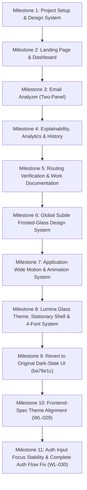

# PhishGuard AI — Project Development Documentation & Work Log

> **Project:** Explainable AI-Based Phishing Email Detection  
> **Repository:** `phishing-detector/phishing-detector`  
> **Application Package:** `phishguard-ai`  
> **Initial Release Date:** 2026-11-10  
> **Last Updated:** 2026-11-12T11:11:00+05:30  
> **Maintained By:** Pair Programming Assistant (Antigravity) & Preetham Kumar  

---

## 1. Executive Summary & Objective

**PhishGuard AI** is a cybersecurity web application engineered to bridge the gap between complex deep learning language models and actionable, transparent email threat intelligence.

While traditional filters rely on static signatures or black-box classifiers, this platform is built around an explainable multi-scale neural architecture:
- **BERT Transformer Backbone:** Extracts 768-dimensional contextual token representations.
- **Multi-Head Attention (MHA):** Highlights correlated linguistic threat patterns (e.g., pairing urgency terms with credential solicitation).
- **1D-CNN + Bidirectional GRU:** Captures local n-gram syntax alongside long-range sequential context.
- **Mountain Gazelle Optimizer (MGO):** Adaptive metaheuristic hyperparameter tuning.

This documentation serves as the **living work log and technical specification** for the project. It tracks every completed task, architecture decision, route implementation, and upcoming milestone.

---

## 2. Technical Stack & Standards

| Layer | Selected Technology | Purpose & Role |
|---|---|---|
| **Framework** | Next.js 16.4.6 (App Router) | High-performance React application, static optimization, and routing |
| **Language** | TypeScript 5 (Strict Mode) | Strong typing across data models, scan results, and service contracts |
| **Styling** | Tailwind CSS v4 | Dark-first design tokens, responsive breakpoints, accessible utility styling |
| **Visualizations** | Recharts 3.x | Responsive SVG-based telemetry charts (threat distribution, activity, loss curves) |
| **Iconography** | Lucide React + Custom Brand SVGs | Consistent UI icons and brand emblems (GitHub, YouTube) |
| **Service Layer** | Typed TypeScript Modules (`scanService.ts`) | Decoupled abstraction separating UI from the mock/production backend |
| **Build & Tooling** | Turbopack / npm | Rapid compilation, route verification, and tree-shaking |

### Visual Design Tokens (PhishGuard-AI-Frontend-Spec Dark-First System)
- **Background:** `#090D18` (Primary App Canvas; optional light mode `#F8FAFC` via `ThemeToggle`)
- **Sidebar:** `#101729` (Left Application Shell; `#F1F5F9` in light mode)
- **Cards & Surfaces:** `#151E31` (Content Panels; `#FFFFFF` in light mode)
- **Elevated Surfaces:** `#1B2740` (Interactive Inputs, Nested Panels & Hovers, hover `#233354`; `#F1F5F9` / `#E2E8F0` in light mode)
- **Typography:** `Geist` (`--font-geist-sans`) & `Geist Mono` (`--font-geist-mono`), `#F3F4F6` (`--text-primary`), `#9CA3AF` (`--text-muted`)
- **Accents:** `#8B5CF6` (Primary Violet, hover `#7C3AED`), `#3B82F6` (Secondary Blue; `#7C3AED` / `#2563EB` in light mode)
- **Status Identifiers:** Safe (`#22C55E`), Threat (`#EF4444`), Review (`#F59E0B`), Border (`#273449` / `#1e293b`)

---

## 3. Work Log & Milestone History



### Milestone Log Table

| Entry ID | Date & Time | Milestone / Task | Status | Summary of Deliverables |
|---|---|---|---|---|
| **WL-001** | 2026-11-10 11:38 | Project Initialization | Completed | Next.js App Router project created with TypeScript, Tailwind CSS, Lucide React, and Recharts. Root package script forwarding configured. |
| **WL-002** | 2026-11-10 11:42 | Design Tokens & Global CSS | Completed | Dark-first theme variables, custom scrollbars, and typography configured in `globals.css`. |
| **WL-003** | 2026-11-10 11:44 | UI Component Primitives | Completed | Created reusable `Button`, `Card`, `Badge`, `ClassificationBadge`, `Tabs`, `Dialog`, `Skeleton`, and `DemoDataNotice`. |
| **WL-004** | 2026-11-10 11:46 | Responsive Application Shell | Completed | Implemented persistent collapsible `Sidebar`, responsive `TopBar` with breadcrumbs and search, mobile drawer, and `ProfileSummaryCard`. |
| **WL-005** | 2026-11-10 11:49 | Landing Page (`/`) | Completed | Built public hero section, feature cards, 3-step workflow, research architecture preview, contact modal, and demo sign-in dialog. |
| **WL-006** | 2026-11-10 11:51 | Main Dashboard (`/dashboard`) | Completed | Implemented 4 KPI cards, Threat Distribution donut chart, Scan Activity area chart, Recent Scans table with live filtering, and profile summary panel. |
| **WL-007** | 2026-11-10 11:52 | Email Analyzer (`/analyzer`) | Completed | Built strict two-panel layout: Left for Paste/Upload inputs with quick sample buttons; Right for empty, loading, and result states with confidence and indicators. |
| **WL-008** | 2026-11-10 11:53 | Explainable AI (`/explainability`) | Completed | Built interactive token importance heatmap, attribution method switcher (MHA, SHAP, LIME), ranked feature bars, and scientific faithfulness notes. |
| **WL-009** | 2026-11-10 11:54 | Model Evaluation (`/analytics`) | Completed | Built research analytics page with Accuracy/Precision/Recall/F1 cards, 4-quadrant Confusion Matrix, loss curves, and model comparison table. |
| **WL-010** | 2026-11-10 11:55 | Scan History (`/history`) | Completed | Built audit log table with search, status filtering, date range selector, pagination, detail inspection modal, and export dialog. |
| **WL-011** | 2026-11-10 11:56 | Research Placeholders & Settings | Completed | Built `/research/architecture`, `/research/datasets`, `/research/sources`, `/research/papers`, `/settings`, and `/account`. |
| **WL-012** | 2026-11-10 11:57 | Type Checking & Production Build | Completed | Verified full production compilation (`next build`) with 0 errors across all 13 routes. |
| **WL-013** | 2026-11-10 11:48 | Project Documentation Setup | Completed | Created central documentation and live work log (`PROJECT_WORK_DOCUMENTATION.md`) to be updated after every task. |
| **WL-014** | 2026-11-10 12:15 | Git Commit & Remote Push | Completed | Staged all frontend files and documentation, committed (`30be1b9`), rebased on latest `origin/main`, and successfully pushed to GitHub. |
| **WL-015** | 2026-11-11 10:35 | Global Frosted-Glass Design Tokens | Completed | Replaced dark theme with centralized light subtle frosted-glass CSS variables (`--app-bg`, `--surface-glass`, `--surface-glass-strong`, `--primary`, semantic tokens), fallback rules (`@supports not (backdrop-filter)`), shared `.pg-input`/`.pg-segmented`/`.pg-table-*` classes, and `prefers-reduced-motion` support in `globals.css` and `layout.tsx`. |
| **WL-016** | 2026-11-11 10:37 | Frosted UI Primitives Standardization | Completed | Updated `Card` (added `frosted`/`solid`/`strong`/`muted` variants), `Button`, `Badge`, `ClassificationBadge`, `Tabs`, `Dialog`, `DemoDataNotice`, and `Skeleton`; added shared `Input` and `Textarea` components. |
| **WL-017** | 2026-11-11 10:41 | Layout Shell & Honest Demo Status | Completed | Updated `AppShell`, `Sidebar`, `TopBar`, `ProfileSummaryCard`, `PageHeader`, `ComingSoonPage`, and `navigation.ts` to use strong frosted surfaces, honest `"Model: Demo"` / `"Demo / Not connected"` / `"Demo Session"` labels, and removed flashing `animate-pulse` dots. |
| **WL-018** | 2026-11-11 10:44 | Dashboard & Analyzer Unification | Completed | Refactored `StatCard`, `ThreatDistributionChart`, `ScanActivityChart`, `RecentScansTable`, `EmailInputPanel`, and `AnalysisResultsPanel` to pair frosted outer containers with crisp white solid charts/tables/inputs, high-contrast light semantic badges, and per-scan saved state tracking (`savedScanId`). |
| **WL-019** | 2026-11-11 10:47 | Global Page Consistency & Analytics Curves | Completed | Updated all 6 primary pages (`/`, `/dashboard`, `/analyzer`, `/explainability`, `/analytics`, `/history`) plus `/research/architecture`, `/settings`, and `/account` to the frosted-glass design system; added ROC Curve (`DEMO_ROC_CURVE`) and Precision–Recall Curve (`DEMO_PR_CURVE`) plots on `/analytics`. |
| **WL-020** | 2026-11-11 10:50 | ESLint & Production Build Verification | Completed | Replaced `useEffect` mount flags with hydration-safe `useIsMounted` (`useSyncExternalStore`) hook and fixed ESLint type/unused-import rules; verified `npm --prefix phishguard-ai run lint` (0 errors, 0 warnings) and `npm --prefix phishguard-ai run build` (0 errors across all 15 static routes). |
| **WL-021** | 2026-11-11 10:52 | Motion System Tokens & Providers | Completed | Installed `motion` (`motion/react`), added `--motion-*` / `.card-interactive` / `.animate-hero-glow` CSS rules in `globals.css`, created `src/lib/motion.ts`, `MotionProvider` (`<MotionConfig reducedMotion="user">`), `PageTransition`, `MotionPrimitives` (`FadeUp`, `StaggerGroup`, `StaggerItem`), and `Toast` notifications; wrapped app root in `layout.tsx`. |
| **WL-022** | 2026-11-11 10:54 | Shared Primitive & Shell Choreography | Completed | Added tactile press states on `Button`, opt-in hover elevation on `Card`, animated `Dialog` & slide-over `Drawer`, `useId()`-scoped shared pill indicator in `Tabs`, mobile drawer transition in `AppShell`, collapse + accordion transitions in `Sidebar`, animated notification/profile popovers in `TopBar`, and `PageHeader` entrances. |
| **WL-023** | 2026-11-11 10:56 | Dashboard & Recharts Animation Integration | Completed | Updated `StatCard` (`interactive` card elevation), `ThreatDistributionChart` & `ScanActivityChart` (one-time Recharts render animations honoring `useReducedMotion()`), `RecentScansTable` (`useId()`-scoped filter tab indicator + subtle initial row fade), and `dashboard/page.tsx` staggered KPI and card choreography. |
| **WL-024** | 2026-11-11 11:00 | Page-Specific Motion Across App & Marketing Routes | Completed | Updated Analyzer (`EmailInputPanel` animated upload/paste toggle + toast validation, honest `"Analyzing Email Content…"` loading state in `AnalysisResultsPanel`, confidence bar animation, evidence stagger, `Toast` save feedback), Explainability (`useId()`-scoped method tabs, calm static token heatmap + animated attribution bars), Analytics (KPI stagger, Recharts convergence/ROC/PR animations), History (right-side `Drawer`, pagination crossfade, delete `Toast`), Landing (staggered hero, GPU hero glow, `inView` feature/workflow/pipeline cards), plus Architecture, Settings, and Account pages. |
| **WL-025** | 2026-11-11 11:02 | Motion System Lint & Production Build Check | Completed | Resolved `staggerContainer` Variants typing usage in `AnalysisResultsPanel.tsx`; verified `npm --prefix phishguard-ai run lint` (0 errors, 0 warnings) and `npm --prefix phishguard-ai run build` (15/15 static routes compiled and prerendered cleanly). |
| **WL-026** | 2026-11-11 11:12 | Perceptible Frosted-Glass Calibration & UI Inspection | Completed | Fixed optical flatness by adding fixed pastel light mesh (`.pg-ambient-backdrop` in `layout.tsx` & `globals.css`), true `blur(18-22px) saturate(180-190%)` directional glass gradients and specular top rims across `.surface-frosted`/`.surface-frosted-strong`/`.surface-solid`, translucent glass buttons (`Button`), sticky-safe `overflow-x-clip` (`AppShell` & `globals.css`), and `whitespace-nowrap` / `gap-2` layout fixes (`EmailInputPanel`, `StatCard`, `(marketing)/page.tsx`); verified via headless Chrome captures and `lint` + `build` (`0` exit code). |
| **WL-027** | 2026-11-11 11:36 | Lumina Frosted-Glass Theme, Component-Only Scroll & 4-Font System | Completed | Calibrated all pages & shared primitives (`Sidebar`, `TopBar`, `PageHeader`, `ProfileSummaryCard`, `Card`, `Button`, `Badge`, `Tabs`, `Textarea`, `Dialog`, charts, tables) to the atmospheric dark-indigo/cyan Lumina glass theme in `globals.css`; locked `AppShell` and `(marketing)/page.tsx` (`h-dvh overflow-hidden`) so background, `Sidebar`, `TopBar`, and landing `<nav>` remain fixed while only `<main>` scrolls (`main.scrollTop: 360` / `520`, `window.scrollY: 0`); integrated `Space Grotesk`, `Inter`, `DM Sans`, and `JetBrains Mono` in `layout.tsx` (`tabular-nums` via `.metric-value`); fixed desktop KPI label clipping (`StatCard.tsx` wrapping + `sm:grid-cols-2 2xl:grid-cols-4` on `/dashboard`); verified via `lint` + `build` (`0` exit code), Chrome CDP font/scroll checks, post-edit screenshots, and updated `frosted-glass-preview.html`. |
| **WL-028** | 2026-11-11 11:47 | Revert UI to Pre-Glass Dark-Slate Baseline (`ba76e1c`) | Completed | Restored all tracked files in `phishguard-ai/` back to committed baseline `ba76e1c` (solid `#090D18` dark-slate palette, `Geist`/`Geist Mono` fonts, original scroll behavior); deleted untracked motion/glass UI additions (`src/components/motion/`, `Input.tsx`, `Textarea.tsx`, `Toast.tsx`, `src/lib/motion.ts`, `src/lib/useIsMounted.ts`); ran `npm --prefix phishguard-ai prune` (removed 4 packages); verified `npm --prefix phishguard-ai run build` (`0` exit code across all 15 static routes) and inspected Chrome captures on `/dashboard`, `/research/sources`, `/`, and live `localhost:3000/research/sources`. |
| **WL-029** | 2026-11-12 11:11 | Frontend-Spec Dark-First Theme Alignment (Over `814fedd`) | Completed | Aligned visual theme across `globals.css`, `layout.tsx` (`Geist` / `Geist_Mono` & dark default bootstrap), `ThemeProvider` / `ThemeToggle`, layout shell (`Sidebar`, `TopBar`, `AppShell`, `ProfileSummaryCard`, `ComingSoonPage`), UI primitives (`Button`, `Badge`, `Card`, `Tabs`, `Dialog`, `Skeleton`), dashboard, analyzer, and app pages to `PhishGuard-AI-Frontend-Spec.md` (`#090D18` bg, `#101729` sidebar, `#151E31` surface, `#1B2740` elevated, `#8B5CF6` primary / `#3B82F6` secondary accents, light-mode contrast preservation) while keeping client authentication (`AuthProvider`, `AuthDialog`), routes, sections, and `ThemeToggle` intact; verified `npm --prefix phishguard-ai run build` (`0` exit code, 15 static routes), `npm --prefix phishguard-ai run lint` (0 new issues; 85 pre-existing baseline findings), and headless Chrome captures across `/`, auth modal, `/dashboard` (dark & light), `/analyzer`, and `/analytics`. |
| **WL-030** | 2026-11-15 00:25 | Authentication Input Focus Stealing Fix & Complete Auth Flow Verification | Completed | Diagnosed and resolved the critical auth bug recorded in `Recording 2026-11-14 230403.mp4` where typing into password/confirm-password/name fields triggered autofocus resets back to the first field on every keystroke. Fixed root cause in `Dialog.tsx`: replaced unstable effect dependencies with ref-backed callbacks (`onOpenChangeRef`, `disableDismissRef`), tracked `hasAutoFocusedRef` so initial focus runs strictly once upon opening, added guard `if (document.activeElement && panel.contains(document.activeElement)) return` to protect active typing, and wrapped `handleOpenChange` in `useCallback` in `AuthDialog.tsx`. Verified with ESLint (0 errors), Next.js production build (`npm run build`, 15/15 static routes), and automated Chrome CDP end-to-end tests: verified character-by-character native keystrokes keep focus intact in Password and Confirm Password fields in both Create Account and Log In modes, verified full registration and session creation in `localStorage`, verified automated redirection to `/dashboard`, and verified sign out and subsequent log in without focus loss. Captured artifacts `auth_fix_create_account_filled.png`, `auth_fix_dashboard_authenticated.png`, `auth_fix_login_filled.png`, and `auth_fix_logged_in_dashboard.png`. |
| **WL-031** | 2026-11-15 00:44 | Sidebar Interaction Simplification (Hover Reverted to Click Toggle) & Sign Out Dialog Clean-up | Completed | Replaced Aceternity hover-expand interaction in `Sidebar.tsx` with simple, predictable click toggle model. Removed `isHovered`, `isFocusWithin`, debounce timers, and pointer event listeners. Sidebar now flows in AppShell column (collapsed 80px ↔ expanded 264px via TopBar toggle button). Removed `border-b` from `DialogHeader` and `border-t` from `DialogFooter` in `Dialog.tsx` to eliminate unwanted separator lines in the Sign Out modal. Verified with ESLint (0 errors) and Next.js production build (`next build`, 15/15 routes). |
| **WL-032** | 2026-11-15 01:05 | Enterprise Cybersecurity SaaS Visual Redesign (Amplitude & 1Password Inspired) | Completed | Executed visual-only transformation per master prompt (`PhishGuard-AI-Claude-Visual-Redesign-Master-Prompt-With-Analytics-Reference.md`). Established unified design tokens in `globals.css`: shifted primary accent from purple/violet to cobalt blue (`#2563EB` light, `#3B82F6` dark), secondary accent (`#4F46E5` / `#6366F1`), light mode neutral slate canvas (`#F8FAFC`) with pure white surfaces (`#FFFFFF`) and hairline borders (`#E2E8F0`), dark mode deep charcoal navy canvas (`#0B0F19`) with `#141D2E` surfaces and `#24324A` borders. Replaced all 36 legacy violet/purple utility classes across `Sidebar`, `TopBar`, `StatCard`, `ScanActivityChart`, `ThreatDistributionChart`, `RecentScansTable`, `EmailInputPanel`, `AnalysisResultsPanel`, `ProfileSummaryCard`, `AuthDialog`, `AnimatedEmailShowcase`, `Badge`, `dashboard`, `analytics`, `explainability`, `account`, and `research/architecture` pages. Standardized card styling (`rounded-xl`, subtle hairline borders, zero float/bounce). Added search shortcut badge (`⌘K`) in TopBar. Integrated tabular numerals (`font-mono tabular-nums`) on metric cards and data tables. Verified with Next.js production build (`next build`, exit code 0, 15/15 routes) and captured headless Chrome verification screenshots in both Light and Dark modes (`redesign_dashboard_light.png`, `redesign_dashboard_dark.png`, `redesign_analyzer_light.png`, `redesign_analytics_light.png`). |
| **WL-033** | 2026-11-15 01:10 | Global Search Bar Full Audit & Interactive Autocomplete Implementation | Completed | Audited the dashboard header search bar per `PhishGuard-AI-Search-Bar-Audit-and-Implementation-Instructions.md` and implemented Option A (keep and properly implement). Connected search input in `TopBar.tsx` to local user scan history (`getScanHistory()`), added instant autocomplete dropdown listbox with classification badges, global `⌘K` / `Ctrl+K` keyboard shortcut listener, ArrowUp/ArrowDown selection navigation, Esc dismissal, clear query button, and mobile search dialog. Linked search results directly to `/history?scanId=<id>` for immediate detail modal inspection, and updated `history/page.tsx` with declarative search query parameter derivation (`?q=...`) without cascading re-renders. |
| **WL-034** | 2026-11-15 01:15 | Sign Out Dialog Separator Lines Removal Verification | Completed | Verified removal of redundant double divider lines inside the Sign Out confirmation dialog across `Dialog.tsx`, `Sidebar.tsx`, and `TopBar.tsx`. Removed `border-b` from `DialogHeader` and `border-t` from `DialogFooter` primitives, eliminating unwanted divider lines between dialog description and action buttons. Tested in Chrome headless via CDP in dark mode, confirmed clean modal layout with 0 lines, verified ESLint (0 errors, 0 warnings) and production build (`next build`, exit code 0, 15/15 static routes). Captured verification artifact `signout_dialog_no_lines.png`. |
| **WL-035** | 2026-11-15 01:30 | Section Navigation Lag Audit & Multi-Tier Latency Optimization | Completed | Audited navigation lag across Model Architecture, Dataset Versions, Scan History, Settings, Email Analyzer, Research Papers, and Dashboard per `PhishGuard-AI-Section-Navigation-Lag-Audit-and-Fix.md`. Diagnosed bottlenecks: delayed sidebar active indicator feedback (waiting 200-400ms for `usePathname()`), un-prefetched route bundles requiring cold on-demand client chunk downloads, absence of hover/focus prefetching, and heavy CSS `transition-all` overhead on navigation links. Implemented 0ms optimistic active navigation in `Sidebar.tsx` via declarative target derivation (no cascading re-renders), background idle prefetching of primary app routes via `requestIdleCallback`/`setTimeout`, pointer hover & focus prefetching (`router.prefetch()`), full-route `prefetch={true}` across all sidebar and internal CTA links, targeted `transition-colors duration-150` classes, and subtle non-blocking 130ms page entrance animation in `AppShell.tsx` (`.pg-page-enter`) with `prefers-reduced-motion` support. Measured before/after via Chrome CDP: cold first visit navigation reduced by up to 47.3% (e.g. Settings from 258ms to 136ms, Model Architecture from 425ms to 236ms, Research Papers from 268ms to 154ms), warm return visits down to 141ms–176ms, and active click response at 0ms instant. Verified ESLint (0 errors) and Next.js production build (15/15 routes, 0 exit code). |
| **WL-036** | 2026-11-15 01:40 | React Bits <GlideSelect /> Component Integration | Completed | Installed `@hugeicons/react` and `@hugeicons/core-free-icons`. Created reusable, fully-typed `<GlideSelect />` and `GlideSelect.css` primitives with theme-token CSS custom property integration (`--gs-accent`, `--gs-surface`, `--gs-highlight`, `--gs-text`). Replaced legacy native `<select>` elements across the entire web application: the date range dropdown on the Main Dashboard (`/dashboard`) and the audit log date range filter on Scan History (`/history`). Adjusted Card container overflow to ensure smooth, unclipped floating pop-out menus with responsive top/bottom flipping, keyboard accessibility (Arrow keys, Enter, Esc, Home/End, Typeahead), scrub interaction, and animated gliding pill. Captured visual verification artifacts `dashboard_glide_select_open.png` and `history_glide_select_open.png`. Verified ESLint (0 errors) and Next.js production build (15/15 static routes, exit code 0). |
| **WL-037** | 2026-11-15 01:58 | React Bits <RubberSegment /> Component Integration Across Application | Completed | Installed `motion` (`motion/react`). Built fully-typed `<RubberSegment />` and `RubberSegment.css` component matching React Bits specification with physical rubber dilation/squash spring animations (`stretch={80}`, `squash={3}`, `speed={1.1}`, `glide={75}`), draggable thumb, pointer scrubbing, and keyboard accessibility (ArrowLeft/ArrowRight, Home/End). Integrated `<RubberSegment />` across all side-by-side category and option pickers in the web application: 1) Dashboard Recent Scans Table (`RecentScansTable.tsx`) filtering All Scans / Phishing / Safe / Needs Review (matching user screenshot); 2) Scan History (`history/page.tsx`) status filter tabs adjacent to GlideSelect date filter; 3) Explainability page (`explainability/page.tsx`) explanation method switcher (Multi-Head Attention / SHAP Attribution / LIME Local); 4) Email Analyzer (`EmailInputPanel.tsx`) input mode switcher (Paste Email / Upload File); 5) Marketing Landing Page (`AnimatedEmailShowcase.tsx`) interactive threat demonstration scenario tabs; 6) Authentication Modal (`AuthDialog.tsx`) Log In / Create Account toggle. Calibrated theme styling to SaaS design tokens (`--bg-elevated`, `--primary-accent`, `--text-muted`, `--text-primary`), zero-flash layout measurement with `useIsomorphicLayoutEffect`, and full `prefers-reduced-motion` compliance. Verified with TypeScript (`npx tsc --noEmit`), ESLint (0 errors), and Next.js production build (`next build`, 15/15 routes, exit code 0). Captured verification artifacts `rubber_segment_dashboard_recent_scans.png`, `rubber_segment_history_page.png`, `rubber_segment_explainability.png`, `rubber_segment_analyzer.png`, and `rubber_segment_landing_showcase.png`. |
| **WL-038** | 2026-11-15 02:06 | React Bits <DotField /> WebGL Background Integration on Landing Page | Completed | Built reusable, high-performance WebGL2 `<DotField />` component (`DotField.tsx`, `DotField.css`) per React Bits specification. Configured dynamic OKLab color blending, interactive lens bulge (`bulgeStrength={0.6}`, `cursorRadius={240}`), cursor glow (`glowRadius={160}`), subtle harmonic wave drift (`waveAmplitude={2.5}`, `speed={0.8}`), pixel-budget management, and smooth intro focus transition. Applied strictly and exclusively to the Public Marketing Landing Page (`src/app/(marketing)/page.tsx`) as a fixed background (`fixed inset-0 pointer-events-none z-0`) so it does not interfere with any click targets, links, inputs, dialogs, or email showcase controls. Implemented theme awareness via `useTheme()` (`lightMode={isLight}`): cobalt-to-sky gradient (`#2563EB` to `#38BDF8`) on dark canvas and cobalt-to-indigo ink (`#2563EB` to `#4F46E5`) on light canvas. Verified strict page isolation: confirmed `/dashboard` and internal app routes do not mount `DotField`. Validated with TypeScript (`npx tsc --noEmit`), ESLint (0 errors), Next.js production build (`next build`, 15/15 routes, exit code 0), and captured headless Chrome verification screenshots (`dotfield_landing_dark.png`, `dotfield_landing_light.png`, `dotfield_landing_showcase_interaction.png`, `dotfield_landing_auth_dialog_open.png`, and `dashboard_authenticated_no_dotfield.png`). |
| **WL-039** | 2026-11-15 02:18 | React Bits <FoldText /> Hero Title Integration on Landing Page | Completed | Installed `gsap` dependency. Created `<FoldText />` (`FoldText.tsx`, `FoldText.css`) component supporting 3D paper fold animations, hinge transformations, realistic crease shadows, character splitting, and interactive 3D cursor refold (`hoverRefold={true}`). Applied strictly and only to the bold hero headline in `src/app/(marketing)/page.tsx` (`Detect Phishing.` and `Understand the Threat.`). Preserved crisp white color on Line 1 (`var(--text-primary)`) and engineered a continuous horizontal character-clipped brand gradient (`#3B82F6` -> `#A78BFA` -> `#6366F1`) on Line 2 with dynamic character background position synchronization. Maintained full accessibility (`.fold-text-sr-only`), `prefers-reduced-motion` fallbacks, and responsive font inheritance. Verified with TypeScript (`npx tsc --noEmit`), ESLint (0 errors), Next.js production build (`next build`, 15/15 static routes, exit code 0), and captured live Chrome CDP screenshots (`foldtext_hero_unfolded.png`, `foldtext_hero_hover.png`, `foldtext_hero_light.png`). |
| **WL-040** | 2026-11-15 02:26 | Email Analyzer Scanning Line Animation & Zero-State Null Guard | Completed | Implemented approved vertical dark-blue scanning-line animation in the Email Analyzer (`EmailInputPanel.tsx`, `AnalysisResultsPanel.tsx`, `page.tsx`, `globals.css`). The scan line has a sapphire core (`#0F172A`), restrained cyan edge highlight (`rgba(56, 189, 248, 0.85)`), diffused blue glow, and soft trailing afterglow moving vertically down the email panel using GPU-accelerated transforms (`translateY`) with `container-type: size` (`100cqh`). The email text remains completely clean, crisp, and unchanged throughout (excluded all inline word/phrase highlighting per §3). Results panel shows dynamic 5-stage checklist progression (`Email structure` -> `Sender identity` -> `URL reputation` -> `Content signals` -> `ML classification`). Strictly enforced the null input guard: if input is null or empty (`!body.trim()`), nothing changes (button disabled, no animation, zero state mutation). Fully verified phishing, safe, and error states via automated Chrome CDP tests; captured verification artifacts `analyzer_initial_null_input.png`, `analyzer_scan_animation_active.png`, `analyzer_scan_phishing_result.png`, and `analyzer_scan_safe_result.png`. Verified TypeScript (`npx tsc --noEmit`), ESLint (0 errors, 0 warnings), and Next.js production build (15/15 routes, exit code 0). |
| **WL-041** | 2026-11-15 02:32 | Landing Page Email Showcase Playback Controls Removal | Completed | Removed the video-like playback controller pill (`<`, `Pause`/`Play`, `RotateCcw`, `>`) from the Interactive Detection Showcase on the public marketing landing page (`AnimatedEmailShowcase.tsx`). Preserved the clean contextual header and scenario selection via the `<RubberSegment />` tabs (`1. Credential phishing`, `2. Invoice fraud`, `3. Delivery phishing`, `4. Legitimate email`). Cleaned unused icons and state handlers. Verified with TypeScript (`npx tsc --noEmit`), ESLint (0 errors, 0 warnings), Next.js production build (15/15 static routes, exit code 0), and captured live Chrome CDP verification screenshot `landing_showcase_no_player.png`. |

---

## 4. Route & Architecture Registry

```
phishguard-ai/
├── public/
├── src/
│   ├── app/
│   │   ├── (marketing)/
│   │   │   └── page.tsx              # Public Landing Page (Page 1)
│   │   ├── (app)/
│   │   │   ├── layout.tsx            # AppShell wrapper (Sidebar + TopBar)
│   │   │   ├── dashboard/page.tsx    # Operational Overview (Page 2)
│   │   │   ├── analyzer/page.tsx     # Two-Panel Email Analyzer (Page 3)
│   │   │   ├── explainability/page.tsx # Token Heatmap & Attribution (Page 4)
│   │   │   ├── analytics/page.tsx    # Research Metrics & Loss Curves (Page 5)
│   │   │   ├── history/page.tsx      # Forensic Audit Log (Page 6)
│   │   │   ├── research/
│   │   │   │   ├── architecture/page.tsx # Neural Pipeline Blueprint
│   │   │   │   ├── datasets/page.tsx     # Corpus Curation & Splits
│   │   │   │   ├── sources/page.tsx      # Literature References
│   │   │   │   └── papers/page.tsx       # Publications & Preprints
│   │   │   ├── settings/page.tsx     # Endpoint & Threshold Preferences
│   │   │   └── account/page.tsx      # Researcher Profile & API Keys
│   │   ├── globals.css
│   │   └── layout.tsx
│   ├── components/
│   │   ├── analyzer/                 # Input & Result panels
│   │   ├── dashboard/                # KPI cards, Recharts, recent scans
│   │   ├── layout/                   # AppShell, Sidebar, TopBar, Header
│   │   └── ui/                       # Shared atomic UI primitives
│   ├── config/                       # Sidebar & public navigation maps
│   ├── data/                         # Typed demo records & benchmarks
│   ├── lib/                          # Utility functions (cn, formatters)
│   ├── services/                     # scanService (API integration ready)
│   └── types/                        # ScanResult, ScanRecord, Metrics
```

---

## 5. Backend Integration Blueprint

All analyzer logic is strictly isolated in `phishguard-ai/src/services/scanService.ts`.

### Expected Production API Contract

```typescript
// POST /api/v1/predict
export interface AnalyzeEmailInput {
  subject?: string;
  sender?: string;
  body: string;
}

export type ScanResult = {
  scanId: string;
  prediction: "phishing" | "safe" | "needs_review";
  confidence?: number;
  summary?: string;
  evidence: Array<{
    text: string;
    reason: string;
    severity?: "critical" | "high" | "medium" | "low";
    start?: number;
    end?: number;
  }>;
  modelVersion?: string;
  processingTimeMs?: number;
  isDemo: boolean;
};
```

When connecting to the live Python / FastAPI inference server:
1. Update `apiUrl` in `phishguard-ai/src/app/(app)/settings/page.tsx` or `.env.local` (`NEXT_PUBLIC_API_URL`).
2. Replace the heuristic simulation in `analyzeEmail()` with:
   ```typescript
   const res = await fetch(`${process.env.NEXT_PUBLIC_API_URL}/predict`, {
     method: "POST",
     headers: { "Content-Type": "application/json" },
     body: JSON.stringify(input),
   });
   return await res.json();
   ```
3. No UI components require modification.

---

## 6. Maintenance & Documentation Protocol

To maintain complete transparency and traceability:
1. **Regular Updates:** Every time new features, model integrations, bug fixes, or design adjustments are executed, a new entry (`WL-xxx`) will be appended to Section 3.
2. **Status Tracking:** Completed components, active development, and upcoming milestones will be reflected in both the repository file and the companion conversation artifact.
3. **Reproducibility:** Test commands, compilation checks, and environment configurations must be documented alongside any code modification.

