# PhishGuard AI — Project Development Documentation & Work Log

> **Project:** Explainable AI-Based Phishing Email Detection  
> **Repository:** `phishing-detector/phishing-detector`  
> **Application Package:** `phishguard-ai`  
> **Initial Release Date:** 2026-11-10  
> **Last Updated:** 2026-11-15T17:40:00+05:30  
> **Maintained By:** Pair Programming Assistant (Antigravity) & Preetham Kumar  

---

## 1. Executive Summary & Objective

**PhishGuard AI** is a cybersecurity web application engineered to bridge the gap between complex deep learning language models and actionable, transparent email threat intelligence.

While traditional filters rely on static signatures or black-box classifiers, this platform is built around an explainable multi-scale neural architecture:
- **BERT Transformer Backbone:** Extracts 768-dimensional contextual token representations.
- **Multi-Head Attention (MHA):** Highlights correlated linguistic threat patterns (e.g., pairing urgency terms with credential solicitation).
- **1D-CNN + Bidirectional GRU:** Captures local n-gram syntax alongside long-range sequential context.
- **Mountain Gazelle Optimizer (MGO):** Adaptive metaheuristic hyperparameter tuning.

This documentation serves as the **living work log and technical specification** for the project. It tracks every completed task, architecture decision, route implementation, and upcoming milestone.

---

## 2. Technical Stack & Standards

| Layer | Selected Technology | Purpose & Role |
|---|---|---|
| **Framework** | Next.js 16.4.6 (App Router) | High-performance React application, static optimization, and routing |
| **Language** | TypeScript 5 (Strict Mode) | Strong typing across data models, scan results, and service contracts |
| **Styling** | Tailwind CSS v4 | Dark-first design tokens, responsive breakpoints, accessible utility styling |
| **Visualizations** | Recharts 3.x | Responsive SVG-based telemetry charts (threat distribution, activity, loss curves) |
| **Iconography** | Lucide React + Custom Brand SVGs | Consistent UI icons and brand emblems (GitHub, YouTube) |
| **Service Layer** | Typed TypeScript Modules (`scanService.ts`) | Decoupled abstraction separating UI from the mock/production backend |
| **Build & Tooling** | Turbopack / npm | Rapid compilation, route verification, and tree-shaking |

### Visual Design Tokens (PhishGuard-AI-Frontend-Spec Dark-First System)
- **Background:** `#090D18` (Primary App Canvas; optional light mode `#F8FAFC` via `ThemeToggle`)
- **Sidebar:** `#101729` (Left Application Shell; `#F1F5F9` in light mode)
- **Cards & Surfaces:** `#151E31` (Content Panels; `#FFFFFF` in light mode)
- **Elevated Surfaces:** `#1B2740` (Interactive Inputs, Nested Panels & Hovers, hover `#233354`; `#F1F5F9` / `#E2E8F0` in light mode)
- **Typography:** `Geist` (`--font-geist-sans`) & `Geist Mono` (`--font-geist-mono`), `#F3F4F6` (`--text-primary`), `#9CA3AF` (`--text-muted`)
- **Accents:** `#8B5CF6` (Primary Violet, hover `#7C3AED`), `#3B82F6` (Secondary Blue; `#7C3AED` / `#2563EB` in light mode)
- **Status Identifiers:** Safe (`#22C55E`), Threat (`#EF4444`), Review (`#F59E0B`), Border (`#273449` / `#1e293b`)

---

## 3. Work Log & Milestone History

```mermaid
flowchart TD
    M1["Milestone 1: Project Setup & Design System"] --> M2["Milestone 2: Landing Page & Dashboard"]
    M2 --> M3["Milestone 3: Email Analyzer (Two-Panel)"]
    M3 --> M4["Milestone 4: Explainability, Analytics & History"]
    M4 --> M5["Milestone 5: Routing Verification & Work Documentation"]
    M5 --> M6["Milestone 6: Global Subtle Frosted-Glass Design System"]
    M6 --> M7["Milestone 7: Application-Wide Motion & Animation System"]
    M7 --> M8["Milestone 8: Lumina Glass Theme, Stationary Shell & 4-Font System"]
    M8 --> M9["Milestone 9: Revert to Original Dark-Slate UI (ba76e1c)"]
    M9 --> M10["Milestone 10: Frontend-Spec Theme Alignment (WL-029)"]
    M10 --> M11["Milestone 11: Auth Input Focus Stability & Complete Auth Flow Fix (WL-030)"]
    M11 --> M12["Milestone 12: Account & Profile Full-Stack Implementation (WL-046)"]
    M12 --> M13["Milestone 13: Smooth Enhanced Theme Transition (WL-047)"]
    M13 --> M14["Milestone 14: KPI Navigation Bug Fix (WL-048)"]
    M14 --> M15["Milestone 15: 5-Branch Fusion Architecture Update (WL-049)"]
    M15 --> M16["Milestone 16: Account Real Identity & Remove Fake Defaults (WL-050)"]
    M16 --> M17["Milestone 17: Multicolor Radiant Border System (WL-051)"]
    M17 --> M18["Milestone 18: Complete Frontend Rebuild per Editorial Spec & Zero Architecture/Dataset Tolerance (WL-052)"]
    M18 --> M19["Milestone 19: Dedicated Profile Section Implementation & Top Navigation Integration (WL-053)"]
    M19 --> M20["Milestone 20: Fixed Frosted-Glass Nav, Durable Micro-Interactions, System Radii & Home Box Removal (WL-056)"]
    M20 --> M21["Milestone 21: Scoped Hover Removal & Obsolete Feature Cleanup (WL-057)"]
```



### Milestone Log Table

| Entry ID | Date & Time | Milestone / Task | Status | Summary of Deliverables |
|---|---|---|---|---|
| **WL-001** | 2026-11-10 11:38 | Project Initialization | Completed | Next.js App Router project created with TypeScript, Tailwind CSS, Lucide React, and Recharts. Root package script forwarding configured. |
| **WL-002** | 2026-11-10 11:42 | Design Tokens & Global CSS | Completed | Dark-first theme variables, custom scrollbars, and typography configured in `globals.css`. |
| **WL-003** | 2026-11-10 11:44 | UI Component Primitives | Completed | Created reusable `Button`, `Card`, `Badge`, `ClassificationBadge`, `Tabs`, `Dialog`, `Skeleton`, and `DemoDataNotice`. |
| **WL-004** | 2026-11-10 11:46 | Responsive Application Shell | Completed | Implemented persistent collapsible `Sidebar`, responsive `TopBar` with breadcrumbs and search, mobile drawer, and `ProfileSummaryCard`. |
| **WL-005** | 2026-11-10 11:49 | Landing Page (`/`) | Completed | Built public hero section, feature cards, 3-step workflow, research architecture preview, contact modal, and demo sign-in dialog. |
| **WL-006** | 2026-11-10 11:51 | Main Dashboard (`/dashboard`) | Completed | Implemented 4 KPI cards, Threat Distribution donut chart, Scan Activity area chart, Recent Scans table with live filtering, and profile summary panel. |
| **WL-007** | 2026-11-10 11:52 | Email Analyzer (`/analyzer`) | Completed | Built strict two-panel layout: Left for Paste/Upload inputs with quick sample buttons; Right for empty, loading, and result states with confidence and indicators. |
| **WL-008** | 2026-11-10 11:53 | Explainable AI (`/explainability`) | Completed | Built interactive token importance heatmap, attribution method switcher (MHA, SHAP, LIME), ranked feature bars, and scientific faithfulness notes. |
| **WL-009** | 2026-11-10 11:54 | Model Evaluation (`/analytics`) | Completed | Built research analytics page with Accuracy/Precision/Recall/F1 cards, 4-quadrant Confusion Matrix, loss curves, and model comparison table. |
| **WL-010** | 2026-11-10 11:55 | Scan History (`/history`) | Completed | Built audit log table with search, status filtering, date range selector, pagination, detail inspection modal, and export dialog. |
| **WL-011** | 2026-11-10 11:56 | Research Placeholders & Settings | Completed | Built `/research/architecture`, `/research/datasets`, `/research/sources`, `/research/papers`, `/settings`, and `/account`. |
| **WL-012** | 2026-11-10 11:57 | Type Checking & Production Build | Completed | Verified full production compilation (`next build`) with 0 errors across all 13 routes. |
| **WL-013** | 2026-11-10 11:48 | Project Documentation Setup | Completed | Created central documentation and live work log (`PROJECT_WORK_DOCUMENTATION.md`) to be updated after every task. |
| **WL-014** | 2026-11-10 12:15 | Git Commit & Remote Push | Completed | Staged all frontend files and documentation, committed (`30be1b9`), rebased on latest `origin/main`, and successfully pushed to GitHub. |
| **WL-015** | 2026-11-11 10:35 | Global Frosted-Glass Design Tokens | Completed | Replaced dark theme with centralized light subtle frosted-glass CSS variables (`--app-bg`, `--surface-glass`, `--surface-glass-strong`, `--primary`, semantic tokens), fallback rules (`@supports not (backdrop-filter)`), shared `.pg-input`/`.pg-segmented`/`.pg-table-*` classes, and `prefers-reduced-motion` support in `globals.css` and `layout.tsx`. |
| **WL-016** | 2026-11-11 10:37 | Frosted UI Primitives Standardization | Completed | Updated `Card` (added `frosted`/`solid`/`strong`/`muted` variants), `Button`, `Badge`, `ClassificationBadge`, `Tabs`, `Dialog`, `DemoDataNotice`, and `Skeleton`; added shared `Input` and `Textarea` components. |
| **WL-017** | 2026-11-11 10:41 | Layout Shell & Honest Demo Status | Completed | Updated `AppShell`, `Sidebar`, `TopBar`, `ProfileSummaryCard`, `PageHeader`, `ComingSoonPage`, and `navigation.ts` to use strong frosted surfaces, honest `"Model: Demo"` / `"Demo / Not connected"` / `"Demo Session"` labels, and removed flashing `animate-pulse` dots. |
| **WL-018** | 2026-11-11 10:44 | Dashboard & Analyzer Unification | Completed | Refactored `StatCard`, `ThreatDistributionChart`, `ScanActivityChart`, `RecentScansTable`, `EmailInputPanel`, and `AnalysisResultsPanel` to pair frosted outer containers with crisp white solid charts/tables/inputs, high-contrast light semantic badges, and per-scan saved state tracking (`savedScanId`). |
| **WL-019** | 2026-11-11 10:47 | Global Page Consistency & Analytics Curves | Completed | Updated all 6 primary pages (`/`, `/dashboard`, `/analyzer`, `/explainability`, `/analytics`, `/history`) plus `/research/architecture`, `/settings`, and `/account` to the frosted-glass design system; added ROC Curve (`DEMO_ROC_CURVE`) and Precision–Recall Curve (`DEMO_PR_CURVE`) plots on `/analytics`. |
| **WL-020** | 2026-11-11 10:50 | ESLint & Production Build Verification | Completed | Replaced `useEffect` mount flags with hydration-safe `useIsMounted` (`useSyncExternalStore`) hook and fixed ESLint type/unused-import rules; verified `npm --prefix phishguard-ai run lint` (0 errors, 0 warnings) and `npm --prefix phishguard-ai run build` (0 errors across all 15 static routes). |
| **WL-021** | 2026-11-11 10:52 | Motion System Tokens & Providers | Completed | Installed `motion` (`motion/react`), added `--motion-*` / `.card-interactive` / `.animate-hero-glow` CSS rules in `globals.css`, created `src/lib/motion.ts`, `MotionProvider` (`<MotionConfig reducedMotion="user">`), `PageTransition`, `MotionPrimitives` (`FadeUp`, `StaggerGroup`, `StaggerItem`), and `Toast` notifications; wrapped app root in `layout.tsx`. |
| **WL-022** | 2026-11-11 10:54 | Shared Primitive & Shell Choreography | Completed | Added tactile press states on `Button`, opt-in hover elevation on `Card`, animated `Dialog` & slide-over `Drawer`, `useId()`-scoped shared pill indicator in `Tabs`, mobile drawer transition in `AppShell`, collapse + accordion transitions in `Sidebar`, animated notification/profile popovers in `TopBar`, and `PageHeader` entrances. |
| **WL-023** | 2026-11-11 10:56 | Dashboard & Recharts Animation Integration | Completed | Updated `StatCard` (`interactive` card elevation), `ThreatDistributionChart` & `ScanActivityChart` (one-time Recharts render animations honoring `useReducedMotion()`), `RecentScansTable` (`useId()`-scoped filter tab indicator + subtle initial row fade), and `dashboard/page.tsx` staggered KPI and card choreography. |
| **WL-024** | 2026-11-11 11:00 | Page-Specific Motion Across App & Marketing Routes | Completed | Updated Analyzer (`EmailInputPanel` animated upload/paste toggle + toast validation, honest `"Analyzing Email Content…"` loading state in `AnalysisResultsPanel`, confidence bar animation, evidence stagger, `Toast` save feedback), Explainability (`useId()`-scoped method tabs, calm static token heatmap + animated attribution bars), Analytics (KPI stagger, Recharts convergence/ROC/PR animations), History (right-side `Drawer`, pagination crossfade, delete `Toast`), Landing (staggered hero, GPU hero glow, `inView` feature/workflow/pipeline cards), plus Architecture, Settings, and Account pages. |
| **WL-025** | 2026-11-11 11:02 | Motion System Lint & Production Build Check | Completed | Resolved `staggerContainer` Variants typing usage in `AnalysisResultsPanel.tsx`; verified `npm --prefix phishguard-ai run lint` (0 errors, 0 warnings) and `npm --prefix phishguard-ai run build` (15/15 static routes compiled and prerendered cleanly). |
| **WL-026** | 2026-11-11 11:12 | Perceptible Frosted-Glass Calibration & UI Inspection | Completed | Fixed optical flatness by adding fixed pastel light mesh (`.pg-ambient-backdrop` in `layout.tsx` & `globals.css`), true `blur(18-22px) saturate(180-190%)` directional glass gradients and specular top rims across `.surface-frosted`/`.surface-frosted-strong`/`.surface-solid`, translucent glass buttons (`Button`), sticky-safe `overflow-x-clip` (`AppShell` & `globals.css`), and `whitespace-nowrap` / `gap-2` layout fixes (`EmailInputPanel`, `StatCard`, `(marketing)/page.tsx`); verified via headless Chrome captures and `lint` + `build` (`0` exit code). |
| **WL-027** | 2026-11-11 11:36 | Lumina Frosted-Glass Theme, Component-Only Scroll & 4-Font System | Completed | Calibrated all pages & shared primitives (`Sidebar`, `TopBar`, `PageHeader`, `ProfileSummaryCard`, `Card`, `Button`, `Badge`, `Tabs`, `Textarea`, `Dialog`, charts, tables) to the atmospheric dark-indigo/cyan Lumina glass theme in `globals.css`; locked `AppShell` and `(marketing)/page.tsx` (`h-dvh overflow-hidden`) so background, `Sidebar`, `TopBar`, and landing `<nav>` remain fixed while only `<main>` scrolls (`main.scrollTop: 360` / `520`, `window.scrollY: 0`); integrated `Space Grotesk`, `Inter`, `DM Sans`, and `JetBrains Mono` in `layout.tsx` (`tabular-nums` via `.metric-value`); fixed desktop KPI label clipping (`StatCard.tsx` wrapping + `sm:grid-cols-2 2xl:grid-cols-4` on `/dashboard`); verified via `lint` + `build` (`0` exit code), Chrome CDP font/scroll checks, post-edit screenshots, and updated `frosted-glass-preview.html`. |
| **WL-028** | 2026-11-11 11:47 | Revert UI to Pre-Glass Dark-Slate Baseline (`ba76e1c`) | Completed | Restored all tracked files in `phishguard-ai/` back to committed baseline `ba76e1c` (solid `#090D18` dark-slate palette, `Geist`/`Geist Mono` fonts, original scroll behavior); deleted untracked motion/glass UI additions (`src/components/motion/`, `Input.tsx`, `Textarea.tsx`, `Toast.tsx`, `src/lib/motion.ts`, `src/lib/useIsMounted.ts`); ran `npm --prefix phishguard-ai prune` (removed 4 packages); verified `npm --prefix phishguard-ai run build` (`0` exit code across all 15 static routes) and inspected Chrome captures on `/dashboard`, `/research/sources`, `/`, and live `localhost:3000/research/sources`. |
| **WL-029** | 2026-11-12 11:11 | Frontend-Spec Dark-First Theme Alignment (Over `814fedd`) | Completed | Aligned visual theme across `globals.css`, `layout.tsx` (`Geist` / `Geist_Mono` & dark default bootstrap), `ThemeProvider` / `ThemeToggle`, layout shell (`Sidebar`, `TopBar`, `AppShell`, `ProfileSummaryCard`, `ComingSoonPage`), UI primitives (`Button`, `Badge`, `Card`, `Tabs`, `Dialog`, `Skeleton`), dashboard, analyzer, and app pages to `PhishGuard-AI-Frontend-Spec.md` (`#090D18` bg, `#101729` sidebar, `#151E31` surface, `#1B2740` elevated, `#8B5CF6` primary / `#3B82F6` secondary accents, light-mode contrast preservation) while keeping client authentication (`AuthProvider`, `AuthDialog`), routes, sections, and `ThemeToggle` intact; verified `npm --prefix phishguard-ai run build` (`0` exit code, 15 static routes), `npm --prefix phishguard-ai run lint` (0 new issues; 85 pre-existing baseline findings), and headless Chrome captures across `/`, auth modal, `/dashboard` (dark & light), `/analyzer`, and `/analytics`. |
| **WL-030** | 2026-11-15 00:25 | Authentication Input Focus Stealing Fix & Complete Auth Flow Verification | Completed | Diagnosed and resolved the critical auth bug recorded in `Recording 2026-11-14 230403.mp4` where typing into password/confirm-password/name fields triggered autofocus resets back to the first field on every keystroke. Fixed root cause in `Dialog.tsx`: replaced unstable effect dependencies with ref-backed callbacks (`onOpenChangeRef`, `disableDismissRef`), tracked `hasAutoFocusedRef` so initial focus runs strictly once upon opening, added guard `if (document.activeElement && panel.contains(document.activeElement)) return` to protect active typing, and wrapped `handleOpenChange` in `useCallback` in `AuthDialog.tsx`. Verified with ESLint (0 errors), Next.js production build (`npm run build`, 15/15 static routes), and automated Chrome CDP end-to-end tests: verified character-by-character native keystrokes keep focus intact in Password and Confirm Password fields in both Create Account and Log In modes, verified full registration and session creation in `localStorage`, verified automated redirection to `/dashboard`, and verified sign out and subsequent log in without focus loss. Captured artifacts `auth_fix_create_account_filled.png`, `auth_fix_dashboard_authenticated.png`, `auth_fix_login_filled.png`, and `auth_fix_logged_in_dashboard.png`. |
| **WL-031** | 2026-11-15 00:44 | Sidebar Interaction Simplification (Hover Reverted to Click Toggle) & Sign Out Dialog Clean-up | Completed | Replaced Aceternity hover-expand interaction in `Sidebar.tsx` with simple, predictable click toggle model. Removed `isHovered`, `isFocusWithin`, debounce timers, and pointer event listeners. Sidebar now flows in AppShell column (collapsed 80px ↔ expanded 264px via TopBar toggle button). Removed `border-b` from `DialogHeader` and `border-t` from `DialogFooter` in `Dialog.tsx` to eliminate unwanted separator lines in the Sign Out modal. Verified with ESLint (0 errors) and Next.js production build (`next build`, 15/15 routes). |
| **WL-032** | 2026-11-15 01:05 | Enterprise Cybersecurity SaaS Visual Redesign (Amplitude & 1Password Inspired) | Completed | Executed visual-only transformation per master prompt (`PhishGuard-AI-Claude-Visual-Redesign-Master-Prompt-With-Analytics-Reference.md`). Established unified design tokens in `globals.css`: shifted primary accent from purple/violet to cobalt blue (`#2563EB` light, `#3B82F6` dark), secondary accent (`#4F46E5` / `#6366F1`), light mode neutral slate canvas (`#F8FAFC`) with pure white surfaces (`#FFFFFF`) and hairline borders (`#E2E8F0`), dark mode deep charcoal navy canvas (`#0B0F19`) with `#141D2E` surfaces and `#24324A` borders. Replaced all 36 legacy violet/purple utility classes across `Sidebar`, `TopBar`, `StatCard`, `ScanActivityChart`, `ThreatDistributionChart`, `RecentScansTable`, `EmailInputPanel`, `AnalysisResultsPanel`, `ProfileSummaryCard`, `AuthDialog`, `AnimatedEmailShowcase`, `Badge`, `dashboard`, `analytics`, `explainability`, `account`, and `research/architecture` pages. Standardized card styling (`rounded-xl`, subtle hairline borders, zero float/bounce). Added search shortcut badge (`⌘K`) in TopBar. Integrated tabular numerals (`font-mono tabular-nums`) on metric cards and data tables. Verified with Next.js production build (`next build`, exit code 0, 15/15 routes) and captured headless Chrome verification screenshots in both Light and Dark modes (`redesign_dashboard_light.png`, `redesign_dashboard_dark.png`, `redesign_analyzer_light.png`, `redesign_analytics_light.png`). |
| **WL-033** | 2026-11-15 01:10 | Global Search Bar Full Audit & Interactive Autocomplete Implementation | Completed | Audited the dashboard header search bar per `PhishGuard-AI-Search-Bar-Audit-and-Implementation-Instructions.md` and implemented Option A (keep and properly implement). Connected search input in `TopBar.tsx` to local user scan history (`getScanHistory()`), added instant autocomplete dropdown listbox with classification badges, global `⌘K` / `Ctrl+K` keyboard shortcut listener, ArrowUp/ArrowDown selection navigation, Esc dismissal, clear query button, and mobile search dialog. Linked search results directly to `/history?scanId=<id>` for immediate detail modal inspection, and updated `history/page.tsx` with declarative search query parameter derivation (`?q=...`) without cascading re-renders. |
| **WL-034** | 2026-11-15 01:15 | Sign Out Dialog Separator Lines Removal Verification | Completed | Verified removal of redundant double divider lines inside the Sign Out confirmation dialog across `Dialog.tsx`, `Sidebar.tsx`, and `TopBar.tsx`. Removed `border-b` from `DialogHeader` and `border-t` from `DialogFooter` primitives, eliminating unwanted divider lines between dialog description and action buttons. Tested in Chrome headless via CDP in dark mode, confirmed clean modal layout with 0 lines, verified ESLint (0 errors, 0 warnings) and production build (`next build`, exit code 0, 15/15 static routes). Captured verification artifact `signout_dialog_no_lines.png`. |
| **WL-035** | 2026-11-15 01:30 | Section Navigation Lag Audit & Multi-Tier Latency Optimization | Completed | Audited navigation lag across Model Architecture, Dataset Versions, Scan History, Settings, Email Analyzer, Research Papers, and Dashboard per `PhishGuard-AI-Section-Navigation-Lag-Audit-and-Fix.md`. Diagnosed bottlenecks: delayed sidebar active indicator feedback (waiting 200-400ms for `usePathname()`), un-prefetched route bundles requiring cold on-demand client chunk downloads, absence of hover/focus prefetching, and heavy CSS `transition-all` overhead on navigation links. Implemented 0ms optimistic active navigation in `Sidebar.tsx` via declarative target derivation (no cascading re-renders), background idle prefetching of primary app routes via `requestIdleCallback`/`setTimeout`, pointer hover & focus prefetching (`router.prefetch()`), full-route `prefetch={true}` across all sidebar and internal CTA links, targeted `transition-colors duration-150` classes, and subtle non-blocking 130ms page entrance animation in `AppShell.tsx` (`.pg-page-enter`) with `prefers-reduced-motion` support. Measured before/after via Chrome CDP: cold first visit navigation reduced by up to 47.3% (e.g. Settings from 258ms to 136ms, Model Architecture from 425ms to 236ms, Research Papers from 268ms to 154ms), warm return visits down to 141ms–176ms, and active click response at 0ms instant. Verified ESLint (0 errors) and Next.js production build (15/15 routes, 0 exit code). |
| **WL-036** | 2026-11-15 01:40 | React Bits <GlideSelect /> Component Integration | Completed | Installed `@hugeicons/react` and `@hugeicons/core-free-icons`. Created reusable, fully-typed `<GlideSelect />` and `GlideSelect.css` primitives with theme-token CSS custom property integration (`--gs-accent`, `--gs-surface`, `--gs-highlight`, `--gs-text`). Replaced legacy native `<select>` elements across the entire web application: the date range dropdown on the Main Dashboard (`/dashboard`) and the audit log date range filter on Scan History (`/history`). Adjusted Card container overflow to ensure smooth, unclipped floating pop-out menus with responsive top/bottom flipping, keyboard accessibility (Arrow keys, Enter, Esc, Home/End, Typeahead), scrub interaction, and animated gliding pill. Captured visual verification artifacts `dashboard_glide_select_open.png` and `history_glide_select_open.png`. Verified ESLint (0 errors) and Next.js production build (15/15 static routes, exit code 0). |
| **WL-037** | 2026-11-15 01:58 | React Bits <RubberSegment /> Component Integration Across Application | Completed | Installed `motion` (`motion/react`). Built fully-typed `<RubberSegment />` and `RubberSegment.css` component matching React Bits specification with physical rubber dilation/squash spring animations (`stretch={80}`, `squash={3}`, `speed={1.1}`, `glide={75}`), draggable thumb, pointer scrubbing, and keyboard accessibility (ArrowLeft/ArrowRight, Home/End). Integrated `<RubberSegment />` across all side-by-side category and option pickers in the web application: 1) Dashboard Recent Scans Table (`RecentScansTable.tsx`) filtering All Scans / Phishing / Safe / Needs Review (matching user screenshot); 2) Scan History (`history/page.tsx`) status filter tabs adjacent to GlideSelect date filter; 3) Explainability page (`explainability/page.tsx`) explanation method switcher (Multi-Head Attention / SHAP Attribution / LIME Local); 4) Email Analyzer (`EmailInputPanel.tsx`) input mode switcher (Paste Email / Upload File); 5) Marketing Landing Page (`AnimatedEmailShowcase.tsx`) interactive threat demonstration scenario tabs; 6) Authentication Modal (`AuthDialog.tsx`) Log In / Create Account toggle. Calibrated theme styling to SaaS design tokens (`--bg-elevated`, `--primary-accent`, `--text-muted`, `--text-primary`), zero-flash layout measurement with `useIsomorphicLayoutEffect`, and full `prefers-reduced-motion` compliance. Verified with TypeScript (`npx tsc --noEmit`), ESLint (0 errors), and Next.js production build (`next build`, 15/15 routes, exit code 0). Captured verification artifacts `rubber_segment_dashboard_recent_scans.png`, `rubber_segment_history_page.png`, `rubber_segment_explainability.png`, `rubber_segment_analyzer.png`, and `rubber_segment_landing_showcase.png`. |
| **WL-038** | 2026-11-15 02:06 | React Bits <DotField /> WebGL Background Integration on Landing Page | Completed | Built reusable, high-performance WebGL2 `<DotField />` component (`DotField.tsx`, `DotField.css`) per React Bits specification. Configured dynamic OKLab color blending, interactive lens bulge (`bulgeStrength={0.6}`, `cursorRadius={240}`), cursor glow (`glowRadius={160}`), subtle harmonic wave drift (`waveAmplitude={2.5}`, `speed={0.8}`), pixel-budget management, and smooth intro focus transition. Applied strictly and exclusively to the Public Marketing Landing Page (`src/app/(marketing)/page.tsx`) as a fixed background (`fixed inset-0 pointer-events-none z-0`) so it does not interfere with any click targets, links, inputs, dialogs, or email showcase controls. Implemented theme awareness via `useTheme()` (`lightMode={isLight}`): cobalt-to-sky gradient (`#2563EB` to `#38BDF8`) on dark canvas and cobalt-to-indigo ink (`#2563EB` to `#4F46E5`) on light canvas. Verified strict page isolation: confirmed `/dashboard` and internal app routes do not mount `DotField`. Validated with TypeScript (`npx tsc --noEmit`), ESLint (0 errors), Next.js production build (`next build`, 15/15 routes, exit code 0), and captured headless Chrome verification screenshots (`dotfield_landing_dark.png`, `dotfield_landing_light.png`, `dotfield_landing_showcase_interaction.png`, `dotfield_landing_auth_dialog_open.png`, and `dashboard_authenticated_no_dotfield.png`). |
| **WL-039** | 2026-11-15 02:18 | React Bits <FoldText /> Hero Title Integration on Landing Page | Completed | Installed `gsap` dependency. Created `<FoldText />` (`FoldText.tsx`, `FoldText.css`) component supporting 3D paper fold animations, hinge transformations, realistic crease shadows, character splitting, and interactive 3D cursor refold (`hoverRefold={true}`). Applied strictly and only to the bold hero headline in `src/app/(marketing)/page.tsx` (`Detect Phishing.` and `Understand the Threat.`). Preserved crisp white color on Line 1 (`var(--text-primary)`) and engineered a continuous horizontal character-clipped brand gradient (`#3B82F6` -> `#A78BFA` -> `#6366F1`) on Line 2 with dynamic character background position synchronization. Maintained full accessibility (`.fold-text-sr-only`), `prefers-reduced-motion` fallbacks, and responsive font inheritance. Verified with TypeScript (`npx tsc --noEmit`), ESLint (0 errors), Next.js production build (`next build`, 15/15 static routes, exit code 0), and captured live Chrome CDP screenshots (`foldtext_hero_unfolded.png`, `foldtext_hero_hover.png`, `foldtext_hero_light.png`). |
| **WL-040** | 2026-11-15 02:26 | Email Analyzer Scanning Line Animation & Zero-State Null Guard | Completed | Implemented approved vertical dark-blue scanning-line animation in the Email Analyzer (`EmailInputPanel.tsx`, `AnalysisResultsPanel.tsx`, `page.tsx`, `globals.css`). The scan line has a sapphire core (`#0F172A`), restrained cyan edge highlight (`rgba(56, 189, 248, 0.85)`), diffused blue glow, and soft trailing afterglow moving vertically down the email panel using GPU-accelerated transforms (`translateY`) with `container-type: size` (`100cqh`). The email text remains completely clean, crisp, and unchanged throughout (excluded all inline word/phrase highlighting per §3). Results panel shows dynamic 5-stage checklist progression (`Email structure` -> `Sender identity` -> `URL reputation` -> `Content signals` -> `ML classification`). Strictly enforced the null input guard: if input is null or empty (`!body.trim()`), nothing changes (button disabled, no animation, zero state mutation). Fully verified phishing, safe, and error states via automated Chrome CDP tests; captured verification artifacts `analyzer_initial_null_input.png`, `analyzer_scan_animation_active.png`, `analyzer_scan_phishing_result.png`, and `analyzer_scan_safe_result.png`. Verified TypeScript (`npx tsc --noEmit`), ESLint (0 errors, 0 warnings), and Next.js production build (15/15 routes, exit code 0). |
| **WL-041** | 2026-11-15 02:32 | Landing Page Email Showcase Playback Controls Removal | Completed | Removed the video-like playback controller pill (`<`, `Pause`/`Play`, `RotateCcw`, `>`) from the Interactive Detection Showcase on the public marketing landing page (`AnimatedEmailShowcase.tsx`). Preserved the clean contextual header and scenario selection via the `<RubberSegment />` tabs (`1. Credential phishing`, `2. Invoice fraud`, `3. Delivery phishing`, `4. Legitimate email`). Cleaned unused icons and state handlers. Verified with TypeScript (`npx tsc --noEmit`), ESLint (0 errors, 0 warnings), Next.js production build (15/15 static routes, exit code 0), and captured live Chrome CDP verification screenshot `landing_showcase_no_player.png`. |
| **WL-040** | 2026-11-15 02:26 | Email Analyzer Scanning Line Animation & Zero-State Null Guard | Completed | Implemented approved vertical dark-blue scanning-line animation in the Email Analyzer (`EmailInputPanel.tsx`, `AnalysisResultsPanel.tsx`, `page.tsx`, `globals.css`). The scan line has a sapphire core (`#0F172A`), restrained cyan edge highlight (`rgba(56, 189, 248, 0.85)`), diffused blue glow, and soft trailing afterglow moving vertically down the email panel using GPU-accelerated transforms (`translateY`) with `container-type: size` (`100cqh`). The email text remains completely clean, crisp, and unchanged throughout (excluded all inline word/phrase highlighting per §3). Results panel shows dynamic 5-stage checklist progression (`Email structure` -> `Sender identity` -> `URL reputation` -> `Content signals` -> `ML classification`). Strictly enforced the null input guard: if input is null or empty (`!body.trim()`), nothing changes (button disabled, no animation, zero state mutation). Fully verified phishing, safe, and error states via automated Chrome CDP tests; captured verification artifacts `analyzer_initial_null_input.png`, `analyzer_scan_animation_active.png`, `analyzer_scan_phishing_result.png`, and `analyzer_scan_safe_result.png`. Verified TypeScript (`npx tsc --noEmit`), ESLint (0 errors, 0 warnings), and Next.js production build (15/15 routes, exit code 0). |
| **WL-041** | 2026-11-15 02:32 | Landing Page Email Showcase Playback Controls Removal | Completed | Removed the video-like playback controller pill (`<`, `Pause`/`Play`, `RotateCcw`, `>`) from the Interactive Detection Showcase on the public marketing landing page (`AnimatedEmailShowcase.tsx`). Preserved the clean contextual header and scenario selection via the `<RubberSegment />` tabs (`1. Credential phishing`, `2. Invoice fraud`, `3. Delivery phishing`, `4. Legitimate email`). Cleaned unused icons and state handlers. Verified with TypeScript (`npx tsc --noEmit`), ESLint (0 errors, 0 warnings), Next.js production build (15/15 static routes, exit code 0), and captured live Chrome CDP verification screenshot `landing_showcase_no_player.png`. |
| **WL-042** | 2026-11-15 05:20 | Modular Landing Page Component & Dedicated Route Extraction | Completed | Extracted the entire marketing landing page implementation into a dedicated, reusable component `<LandingPage />` in `src/components/marketing/LandingPage.tsx` without changing any visual styling, animations, or functionalities. Moved all effects: `<DotField />` WebGL2 interactive background, `<FoldText />` 3D paper fold title with character-clipped brand gradient, `<AnimatedEmailShowcase />`, theme switching (`useTheme`), public navigation, and contact dialog. Refactored root route `src/app/(marketing)/page.tsx` to 5 lines rendering `<LandingPage />`, and created the dedicated individual route `src/app/(marketing)/landing/page.tsx` rendering `<LandingPage />`. Verified with TypeScript (`npx tsc --noEmit`), ESLint (0 errors, 0 warnings), Next.js production build (`16/16` static routes, exit code 0), and captured visual verification screenshots `landing_component_root.png` and `landing_component_route.png`. |
| **WL-043** | 2026-11-15 06:05 | Global Pill-Shaped Button System & Glass Dashboard Search Popover | Completed | Upgraded the application UI with a consistent, premium pill-shaped button system (`rounded-full`, `border-radius: 9999px`) and transformed the dashboard header search into a translucent glass pill with an animated popover card (`TopBar.tsx`, `Button.tsx`, `ThemeToggle.tsx`, `Sidebar.tsx`, `Dialog.tsx`, `LandingPage.tsx`, `EmailInputPanel.tsx`, `history/page.tsx`). Preserved button hierarchy: primary CTAs have subtle magnetic lift (`hover:-translate-y-0.5`, soft blue halo shadow, `active:scale-[0.98]`), secondary/outline buttons feature surface tints and border shifts, directional action icons slide gently on hover (`lucide-arrow-right`, `lucide-chevron-right`, `lucide-arrow-left`), and destructive actions retain clear, restrained semantic styling. Header search field redesigned as a glass pill with backdrop blur, inner highlight reflection, dynamic OS keyboard hint badge (`⌘K` on Mac / `Ctrl K` on Windows/Linux), and smooth focus expansion. Anchored search popover card supports: 1) Initial state with query guidance, suggested filter chips (`Urgent`, `Password`, `Invoice`, `Safe`, `Phishing`), and real per-session recent searches from `sessionStorage`; 2) Live search querying real scan records via `getScanHistory()` with classification badges, confidence scores, and keyboard navigation (`↑↓` navigate, `↵` select); 3) Empty/no-results state with guidance and direct link to Scan History; 4) Graceful dismissal via Escape key, outside click, and route changes. Verified with TypeScript (`npx tsc --noEmit`), ESLint (0 errors, 0 warnings), Next.js production build (`16/16` static routes, exit code 0), and captured live Chrome CDP verification artifacts `pill_buttons_dashboard.png`, `search_popover_open_initial.png`, `search_popover_matching_scans.png`, `search_popover_no_results.png`, `pill_buttons_analyzer_active.png`, `pill_buttons_analyzer_bottom.png`, and `pill_buttons_history.png`. |
| **WL-044** | 2026-11-15 06:40 | Dashboard KPI Staggered Count-Up Animation | Completed | Implemented approved staggered count-up animation for the four primary KPI cards on the operational dashboard (`/dashboard`: `Total Emails Scanned`: `1,428`, `Phishing Detected`: `384`, `Safe Emails`: `972`, `Needs Review`: `72`). Built dedicated, isolated client component `<CountUpNumber />` (`src/components/ui/CountUpNumber.tsx`) using `requestAnimationFrame`, smooth cubic ease-out progression (`easeOutCubic`: $1 - (1 - t)^3$), and 80ms progressive card stagger (0ms, 80ms, 160ms, 240ms; total duration ~1,050ms per card). State updates are strictly localized to the counter span, eliminating parent re-renders and preventing layout shifts via `font-variant-numeric: tabular-nums`. Preserves exact integer formatting and thousands separators (`Intl.NumberFormat('en-US')`). Plays once on initial mount and preserves final values across ordinary re-renders (date filter changes, menus, profile modal). Fully supports `prefers-reduced-motion: reduce` by immediately rendering final target values with zero animation. Integrated into `StatCard.tsx` via `animateCount` and `staggerIndex` props (leaving `/analytics` and other stat cards un-animated). Verified with TypeScript (`npx tsc --noEmit`), ESLint (0 errors, 0 warnings), Next.js production build (`16/16` static routes, exit code 0), and captured live Chrome CDP verification artifacts `kpi_countup_mid_flight.png`, `kpi_countup_settled_final.png`, and `kpi_countup_reduced_motion.png`. |
| **WL-045** | 2026-11-15 07:18 | Conditional Route-Gated Count-Up Animation (Landing -> Dashboard & First-Visit Evaluation) | Completed | Refined the count-up animation system so that the Dashboard KPI animation only executes when arriving directly from the marketing landing page (`/` or `/landing` -> `/dashboard`), preventing animation replays during internal app navigation (e.g. from sidebar, analyzer, history). Extended the count-up animation to the 4 Model Performance evaluation metric cards on `/analytics` (`Test Accuracy`: `97.4%`, `Precision`: `96.8%`, `Recall`: `98.1%`, `Macro F1-Score`: `97.4%`), configured to animate exactly once per user session (on initial visit to the evaluation page) and render instantly on subsequent visits. Enhanced `<CountUpNumber />` with `decimals` and `suffix` support (`decimals={1}`, `suffix="%"`) to accurately animate floating-point percentages without rounding artifacts. Implemented zero-cascading-render session storage state initializers in `DashboardPage`, `AnalyticsPage`, `LandingPage`, and `AppShell` to maintain strict ESLint compliance. Verified with TypeScript (`npx tsc --noEmit`), ESLint (0 errors, 0 warnings), Next.js production build (`16/16` routes), and comprehensive automated Chrome CDP navigation suite testing landing -> dashboard, dashboard -> analytics, analytics -> dashboard, and second-visit analytics flows. |
| **WL-046** | 2026-11-15 14:00 | Full-Stack Account & Profile Implementation & Landing Showcase Player Verification | Completed | Fully redesigned and implemented the server-backed Account & Profile page (`/account`) with 5 dedicated in-page sections (Personal Profile, Security & Privacy, Preferences, Account Activity, Plan & Usage) using desktop left-column navigation and mobile horizontal tabs synchronized with URL search params (`?section=`). Built transactional SQLite database (`.data/phishguard.db`) using Node 24 built-in `node:sqlite` (`DatabaseSync`) with WAL mode, foreign keys, and 5 relational tables: `users`, `user_preferences`, `account_activity`, `user_sessions`, and `user_scans`. Implemented PBKDF2-SHA256 password hashing (210,000 iterations, 16-byte random salt, constant-time verification) and created 10 dynamic route handlers under `/api/account/*`. Personal Profile allows updating name, phone, organization, designation, and bio with database persistence. Security & Privacy validates genuine server-side password changes (timing-safe verification, reject mismatched/weak passwords) and truthfully displays unconfigured 2FA status and active sessions. Preferences provides persistent theme synchronization (dark/light/system) with ThemeProvider, notification toggles, default analysis layout, and timezone. Account Activity presents real audit event logs and scan summaries with category filters. Plan & Usage truthfully presents the Open Research Prototype tier (non-metered, no commercial billing connected) with real database-calculated scan counts. Cleared all fabricated badges and placeholders across `ProfileSummaryCard.tsx`. Verified landing page Interactive Showcase completely omits playback controls pill. Verified with TypeScript (`0 errors`), ESLint (`0 errors, 0 warnings`), Next.js production build (`26/26 routes`, exit code 0), and automated Chrome CDP end-to-end verification suite across all 5 sections. (Commit/push intentionally held locally per user instruction). |
| **WL-047** | 2026-11-15 14:10 | Smooth Enhanced Subtle Theme Transition Animation (Light <-> Dark) | Completed | Replaced instantaneous theme switching with a smooth, enhanced, subtle 550ms ease-out transition across the entire application (`ThemeProvider.tsx`, `ThemeToggle.tsx`, `globals.css`). Engineered dynamic `theme-transitioning` class lifecycle on `document.documentElement` activated exclusively on user theme toggle actions (leaving initial page load instant and zero-flash). Applied global surface transition rules (`550ms cubic-bezier(0.25, 1, 0.5, 1)`) to `background-color`, `border-color`, `color`, `fill`, `stroke`, `box-shadow`, and `backdrop-filter`. Added fixed ambient luminous aurora/dawn wave (`.theme-ambient-wave`) providing a subtle, non-intrusive radial bloom (warm amber/sky on switch to light, deep celestial indigo/sapphire on switch to dark) with `pointer-events-none` and `aria-hidden="true"`. Upgraded `<ThemeToggle />` button with synchronized Sun/Moon dual-icon spring morph (`cubic-bezier(0.34, 1.56, 0.64, 1)`): Sun rotates/scales with warm amber glow, Moon rotates/scales with indigo shadow, accompanied by an animated ripple pulse ring on click. Full `prefers-reduced-motion` compliance immediately bypasses all transitions. Verified with TypeScript (`npx tsc --noEmit`), ESLint (0 errors, 0 warnings), Next.js production build (`26/26 routes`, exit code 0), and automated Chrome CDP tests capturing initial dark, mid-transition light, settled light, mid-transition dark, and settled dark states (`theme_1_dark_initial.png` through `theme_5_dark_settled.png`). (Commit/push held locally per user instruction). |
| **WL-048** | 2026-11-15 14:24 | KPI Count-Up Route Navigation Bug Fix (Client-Side Navigation Lifecycle) | Completed | Diagnosed and resolved the route navigation bug where the Model Performance & Evaluation (`/analytics`) KPI metrics failed to animate when navigating internally from `/dashboard` via client-side routing (Sidebar link). Root cause: React StrictMode double invocation and Next.js `<Link>` route prefetching in `useState(() => fn())` mutated module-level state prematurely prior to mount, flipping the animation gate to false. Engineered React Context `KpiAnimationProvider` and `useKpiAnimation()` hook (`src/context/KpiAnimationContext.tsx`) mounted inside `(app)/layout.tsx`, persisting across all internal client-side navigation within the app shell and resetting cleanly on full browser reload. Completely separated pure state inspection (`shouldAnimateDashboard()`, `shouldAnimateModelEvaluation()`) from lifecycle mutation (`markDashboardAnimated()`, `markModelEvaluationAnimated()`), executing state mutation strictly inside `useEffect` post-mount. Maintained independent one-time animation state: Dashboard counters animate once upon first entry from landing/login; Model Evaluation counters animate once upon first visit from dashboard or internal navigation. Re-visiting already animated pages immediately renders final settled numbers without replaying or flashing zero. Full browser reload initializes a fresh session, allowing the currently loaded page to animate again. Full compliance with `prefers-reduced-motion: reduce`. Verified with TypeScript compiler (`npx tsc --noEmit`, 0 errors), ESLint (0 errors, 0 warnings), Next.js production build (`26/26 routes`, exit code 0), and automated Chrome DevTools Protocol test suite verifying mid-flight count-up progression (`0.0%` -> `45.7%` -> `82.1%` -> `97.4%`), settled states, non-replaying return navigation, reload replay, and screenshot captures (`kpi_test_a_dashboard_settled.png` through `kpi_test_f_analytics_reloaded_animated.png`). (Commit/push held locally per user instruction). |
| **WL-049** | 2026-11-15 14:50 | Final Model Architecture Frontend Update (5-Branch Fusion + Custom ResNet) | Completed | Replaced outdated base-research paper model descriptions (BERT, CNN, GRU, Multi-Head Attention, MGO) across all application pages, components, notifications, and metadata with the project's final authoritative architecture. Rebuilt the Model Architecture page (`/research/architecture`) into an end-to-end interactive 12-stage visualization: Input finance-related email, 6-stage parsing/preprocessing, 5 parallel feature branches (Text 768-d, Financial 18-d with f1-1..f1-18, Security 19-d with f2-1..f2-19, URL 20-d with f3-1..f3-20, Metadata 11-d with f4-1..f4-11), 836-d concatenation fusion, custom feature interaction network built from scratch (projection 836 -> 512, Residual Block 1 [512], Residual Block 2 [512 -> 256], Layer Normalization producing 256-d representation without BERT/CNN/GRU/Attention), dense classification head, validation-calibrated decision thresholding (P_phish >= T -> PHISHING / SAFE), forensic output/evidence, and three-pillar explainability (feature ablation, rule-based text evidence, human-readable explanations). Added high-res blueprint modal viewer (`/images/model-architecture-diagram.png`) with download support and transparent blueprint verification notes explaining diagram typographical artifacts. Upgraded `<Dialog>` with React Portal (`createPortal(..., document.body)`) to prevent page transition transforms from hijacking fixed viewport positioning. Updated related components across LandingPage, AnalyticsPage, AnalyzerPage, AnalysisResultsPanel, ProfileSummaryCard, TopBar, AccountPage, demo data, and scan service. Verified with TypeScript (`npx tsc --noEmit`, 0 errors), ESLint (0 errors, 0 warnings), Next.js production build (`26/26 routes`, exit code 0), and automated Chrome CDP test suite capturing verification artifacts (`architecture_stage1_input_preprocessing.png`, `architecture_stage3_7_feature_branches.png`, `architecture_stage8_9_fusion_resnet.png`, `architecture_stage10_12_decision_explainability.png`, and `architecture_blueprint_modal.png`). (Commit/push held locally per user instruction). |
| **WL-050** | 2026-11-15 17:15 | Account & Profile Real Registered Identity & Removal of Fabricated Defaults | Completed | Eliminated all fabricated identities, mock fallbacks, seed records, and static badges across the Account & Profile implementation (`/account`). Displayed strictly the authenticated user's real registered name and email by default from the server database context. Initialized all optional fields (Phone number, Organization / Institution, Designation / Job title, Biography, and Avatar) to genuinely empty (`null`), displaying subtle, polished `Not added` labels in read-only cards. Implemented exact muted input placeholders for edit mode (`Enter your full name`, `Enter your phone number`, `e.g. University or organization`, `e.g. Security Analyst`, `Write a short bio about yourself`) with strict guarantee that placeholders are never treated or persisted as values. Removed the `evelyn.reed@phishguard.internal` fallback and auto-seed call from `authenticateRequest()` in `auth.ts`, ensuring unauthorized requests return 401 instead of exposing another person's profile. Omitted the static decorative `Active Account` badge per spec, and displayed registration dates strictly from the authenticated user's actual database `created_at` timestamp. Derived avatar initials dynamically from the authenticated user's real name, falling back to a neutral `<User />` icon when unnamed. Added Cancel button state restoration in edit mode. Cleared static badges and hardcoded job titles (`"Research Evaluator"`) from `ProfileSummaryCard.tsx` and `TopBar.tsx`. Validated with TypeScript (`npx tsc --noEmit`, 0 errors), ESLint (0 errors, 0 warnings), Next.js production build (`26/26 routes`, exit code 0), and an automated end-to-end multi-account CDP test suite verifying complete profile data isolation between Account A (Alice Smith) and Account B (Bob Jones), persistence after logout/login, and zero cross-account data leakage. (Commit/push held locally per user instruction). |
| **WL-051** | 2026-11-15 17:40 | Multicolor Radiant Border Implementation Across Major UI Containers | Completed | Implemented continuous, animated multicolor radiant border system according to `PHISHGUARD_MULTICOLOR_RADIANT_BORDER_IMPLEMENTATION_SPEC.md` across all qualifying major PhishGuard AI containers while preserving solid card interiors (`#141D2E` dark mode, `#FFFFFF` light mode), pre-existing radii, and layout geometry. Created reusable, dependency-free CSS system (`globals.css`) with registered `@property --pg-radiant-angle`, `@keyframes pg-radiant-orbit` (14s linear infinite), and full 8-color spectrum conic gradient (`cyan #22d3ee -> electric blue #2f80ff -> violet #8b5cf6 -> magenta #d946ef -> pink #fb7185 -> orange #fb923c -> teal #14b8a6 -> cyan #22d3ee`). Per user refinement, eliminated outer diffuse shadow and card drop-shadow (`box-shadow: none !important`, removed `::after` blurred glow), isolating exclusively the crisp, luminous, animated multicolor perimeter line (`::before` with 1.75px hairline stroke and dual-layer content-box mask exclusion) with zero outer blur cloud or interior bleed. Built typed props (`radiant?: RadiantVariant`, `phase?: 1..6`) into atomic `<Card>` component with default `"standard"` variant, enabling universal application across all pages without layout regressions. Provided variants `subtle` (1.25px, 18s duration) and `static` (45deg angle pinned without orbit). Engineered deterministic 6-phase staggering (`pg-radiant-phase-1` through `pg-radiant-phase-6`, -2.33s steps) and automatic `:nth-of-type(6n+k)` fallback so adjacent containers orbit out of phase. Explicitly excluded buttons, icon buttons, inputs, textareas, selects, tabs, chips, avatars, table rows, and inline notices (`DemoDataNotice`). Full `prefers-reduced-motion: reduce` compliance stopping rotation and pinning border angle to 45deg. Verified with TypeScript (`npx tsc --noEmit`, 0 errors), ESLint (0 errors, 0 warnings), Next.js production build (`26/26 routes`, exit code 0), and automated multi-page Chrome DevTools Protocol test suite across Dashboard, Analytics, Analyzer, Explainability, Architecture, History, Account, Settings, Datasets, and Papers, with pristine screenshots captured (`radiant_dashboard_line_only.png`, `radiant_analytics_line_only.png`, `radiant_architecture_line_only.png`, `radiant_dashboard_line_only_light.png`). (Commit/push held locally per user instruction). |
| **WL-052** | 2026-11-15 23:05 | Complete Editorial Frontend Rebuild per Reference Spec & Complete Architecture/Dataset Removal | Completed | Executed a ground-up rebuild of the entire PhishGuard AI frontend web application strictly aligned with the visual and interaction reference `phishguard-ai.html` and specification `PHISHING_FRONTEND_REBUILD_PROMPT.md`. Enforced a restrained editorial/technical security console aesthetic: muted sage canvas & cards (`#D6D9C8`, `#E3E5D6`, `#ECEEE2`, `#DCDFCE`), dark green-black radial hero and panels (`#131614`, `#1B1F1C`, `#242925`), warm orange accents (`#EF6A1E`, `#D65A10`), semantic status colors (`#D8452B` phish, `#1E9A69` safe), 6px card radius, 4px control radius, and Google fonts Outfit (primary sans) and JetBrains Mono (technical monospace). Completely removed all Architecture and Dataset sections, pages, tabs, links, and cards with zero tolerance; added permanent HTTP 307 redirects from `/research/architecture`, `/research/datasets`, `/research/papers`, `/research/sources`, `/`, and `/landing` to `/dashboard`. Retained strictly 5 horizontal top navigation destinations: Overview (`/dashboard`), Email Analyzer (`/analyzer`), Explainability (`/explainability`), Evaluation (`/analytics` & `/evaluation`), and Scan History (`/history`), plus utility controls (Model service status indicator pill, New scan button, Settings `/settings`, Account `/account`). Implemented rich client-side 68-feature extraction engine (Financial 18, Security 19, URL 20, Metadata 11), multi-branch ablation calculation, sigmoid probability scoring, entity extraction, text evidence highlighting, and real backend scan synchronization (`/api/account/scan`). Tested and verified with TypeScript (`npx tsc --noEmit`, 0 errors), Next.js production build (`27/27` routes prerendered, exit code 0), and automated multi-viewport Chrome CDP test suite across Desktop (1440x900), Tablet (820x1180), and Mobile (390x844) with 10 high-resolution verification screenshots captured. |
| **WL-053** | 2026-11-16 10:45 | Dedicated Profile Section Implementation & Empty-by-Default Field Sanitization | Completed | Added dedicated **Profile** section to PhishGuard AI according to `PHISHGUARD_PROFILE_SECTION_PROMPT.md`. Integrated Profile as the 6th navigation tab immediately following Scan History in the top navigation bar (`TopBar.tsx`, `navigation.ts`), matching font, weights, padding, radius, and active states. Linked top-right avatar shortcut (`initials`, accessible label "Open profile") to the same `/profile` route without creating duplicate routes, and redirected `/account` to `/profile`. Created dedicated `src/app/(app)/profile/page.tsx` adhering to the editorial sage/dark design system with Outfit & JetBrains Mono typography. Strictly eliminated all random or fabricated user details (such as `"Security analyst"`, `"PhishGuard Labs"`, `"Threat Intelligence"`). Preserved strictly the registered identity (`name` and `email`) entered by the user while creating their account, keeping all other profile fields (`role/designation`, `organization`, `phone`, `bio`, `avatar`) completely empty (`null` / `""`) by default. Features 5 interactive sections: (1) **Account Overview** displaying avatar with initials, registered full name, registered email, active status badge, member since timestamp, and clean `Not added` labels for unprovided optional fields; (2) **Personal Information** edit form with real-time input validation, backend persistence via `PATCH /api/account/profile`, saving/success/error feedback, clean optional placeholders, and immutable email protection; (3) **Preferences** persisting genuine settings (theme, start destination, score probability/percent format, threat alerts, local scan caching) to SQLite and localStorage; (4) **Security & Privacy** providing change password flow (`POST /api/account/password` with PBKDF2-SHA256 validation), encryption telemetry, active sessions count, JSON data export, scan history clearing, and sign-out action; and (5) **Account Activity** audit event log. When unauthenticated, displays a clean neutral empty state with an interactive `AuthDialog` sign-in/register flow. Verified with TypeScript (`npx tsc --noEmit`, 0 errors), Next.js production build (`28/28` routes prerendered, exit code 0), and an automated Chrome CDP test suite verifying desktop, tablet, and mobile breakpoints with 7 screenshots captured. |
| **WL-054** | 2026-11-16 19:30 | Next.js Hydration Mismatch Resolution & Empty-by-Default State Integrity Verification | Completed | Diagnosed and completely resolved the Next.js App Router (16.4.6 Turbopack) hydration error displayed as a red `"1 Issue"` badge at the bottom right of the screen on `/dashboard`. Root cause: Synchronous reads from `localStorage` (`phishguard-session`, `pg.profile`, etc.) within `useState(() => ...)` in `PhishGuardContext.tsx` caused the initial client render of the top-bar avatar `<Link href="/profile" className="avatar">` to render with `title="Preetham Kumar · Open profile"` and text `"PK"`, conflicting with the server-rendered HTML which evaluated with empty session (`title="Open profile"` and text `"AN"`). Resolved by: (1) Deferring all browser storage synchronization (`pg.settings`, `phishguard-session`, `phishguard-users`, `pg.profile`, `pg.activity`, `pg.usage`, `pg.eval`, `pg.scans`) exclusively to a post-hydration `useEffect` hook with server-safe initial state defaults; (2) Adding a `mounted` state guard in `TopBar.tsx` so `initials`, `avatarTitle`, and service status labels evaluate identically to `"AN"`, `"Open profile"`, and `"Model service · not connected"` during SSR and initial client reconciliation; (3) Adding `suppressHydrationWarning` on the avatar link and status pill; (4) Fixing TypeScript compilation errors in `PhishGuardContext.tsx` by eliminating duplicate `toasts` declarations and safely initializing `selectedScanId` to `null`; (5) Confirming database and localStorage cleanliness so only user-provided registration credentials (`name` and `email`) are loaded, keeping all optional fields (`designation`, `organization`, `phone`, `bio`) empty (`Not added`). Fully verified with TypeScript (`npx tsc --noEmit`, 0 errors), Next.js production build (`28/28` routes prerendered, exit code 0), and headless Chrome DevTools Protocol verification confirming 0 console hydration errors, total elimination of the red `"1 Issue"` badge, and verified clean rendering of `/dashboard` and `/profile`. |
| **WL-055** | 2026-11-16 19:42 | Refined UI Hover & Micro-Interaction Polish (No-Outline Elevation System) | Completed | Implemented refined, quiet, tactile hover and micro-interaction effects across the PhishGuard application strictly following `PHISHGUARD_REFINED_HOVER_EFFECTS_PROMPT.md`. Enforced the strict **No-Outline / No-Border-Highlight** constraint: zero visible outline, border, ring, stroke, or orange frames on hover across all cards and surfaces; original borders remain completely unchanged. Applied surface-specific tuning: (1) **Interactive Cards & Boxes (`.card`, `.card.warm`, `.card.flat`, `.strip`):** Gentle upward lift (`translateY(-4px)`), micro-zoom (`scale(1.012)`), soft diffused dual-layer shadow (`0 10px 22px rgba(28, 31, 26, 0.07), 0 2px 6px rgba(28, 31, 26, 0.035)`), and very subtle background lighten (`#E6E8DA`) with `220ms cubic-bezier(0.2, 0.75, 0.25, 1)`. Neighboring cards do not move (zero layout shift). (2) **Large Detection Overview Panel (`.panel-dark`):** Pinned to zero displacement and zero scale to protect the complex radar SVG, degree ticks, sparkline, and feed from jitter/distortion; enhanced with a subtle, deep elevation shadow (`0 12px 28px rgba(0, 0, 0, 0.20)`). (3) **Navigation Items (`TopBar` `.tab`):** No lift or zoom; smooth 180ms background color shift to `var(--card-2)` while preserving active page states (`.tab.active`) and zero outlines. (4) **Buttons & Action Controls (`.btn`, `.btn-accent`, `.btn-dark`, `.btn-ghost`, `.btn-line`, `.chip-btn`, `.icon-btn`, `.avatar`, `.go`, `.d-btn`):** Micro-scale (`1.015`), subtle lift (`-1.5px`), and press/active depression feedback (`0.985` scale at 80ms) without bounce. (5) **Threat Badges & Status Labels (`.verdict`, `.tag`, `.code`):** Motionless and color-static to preserve unambiguous classification integrity. (6) **Tables, List Rows & Live-feed Entries (`.tbl tbody tr.clickable`, `.feed button`, `.src-row`, `.li`, `.meter-row`):** Subtle background tint on hover (e.g. `rgba(255, 255, 255, 0.38)`) without row scaling or text jitter. (7) **Analyzer Dropzone (`.drop`):** Removed hover orange border highlight; replaced with gentle lift (`-2px`) and soft shadow, retaining orange border strictly for drag-over events (`.drop.over`). Wrapped all hover effects in `@media (hover: hover) and (pointer: fine)` to protect touch devices from sticky hover states, preserved keyboard `:focus-visible`, and added comprehensive `@media (prefers-reduced-motion: reduce)` overrides. Fully verified with TypeScript (`npx tsc --noEmit`, 0 errors), Next.js production build (`28/28 routes prerendered cleanly`), and headless Chrome CDP automated test suite at desktop, tablet, and mobile breakpoints with 5 verification screenshots captured. |
| **WL-056** | 2026-11-16 20:25 | Fixed Frosted-Glass Nav, Durable Micro-Interactions, System Radii & Home Box Removal | Completed | Implemented all specifications in `PHISHGUARD_FIXED_GLASS_NAV_AND_SURFACE_REFINEMENT_IMPLEMENTATION_PROMPT.md`. (1) **Fixed Frosted-Glass Top Navigation:** Pinned top navigation bar to top of viewport during scrolling (`position: fixed; top: 0; left: 0; right: 0; z-index: 50; width: 100%;`) with translucent frosted glass (`rgba(214, 217, 200, 0.82)`), backdrop blur (`blur(16px) saturate(160%)`), safe solid fallback (`#D6D9C8`), subtle divider border (`1px solid rgba(28, 31, 26, 0.08)`), and soft depth shadow (`0 4px 20px -2px rgba(28, 31, 26, 0.05)`). Defined precise content offset via `.shell` padding (`72px 22px 48px` desktop, `102px 12px 40px` mobile) and `scroll-padding-top: 76px` guaranteeing zero overlap or concealed content. (2) **Polished Navigation-Item Interactions:** Added GPU-friendly micro-interactions to `.tab` with `160ms cubic-bezier(0.2, 0.75, 0.25, 1)`, hover elevation (`translateY(-1px)`), pressed depression (`translateY(0.5px)`), clear focus-visible outline, and durable non-motion/non-color-only active indicator via bottom accent pill (`::after` orange pill: `width: 16px; height: 2.5px; background: var(--accent); border-radius: 2px 2px 0 0;`) paired with `box-shadow: inset 0 0 0 1px ...` and `font-weight: 500`. (3) **Standardized Rounded-Corner System:** Standardized visual surfaces on compact token scale (`--r-lg: 8px;`, `--r: 6px;`, `--r-sm: 4px;`, `--r-xs: 2px;`) across `.card`, `.panel-dark`, `.strip`, `.drop`, with `border-radius: inherit` on pseudo-elements (`.panel-dark::before`) to eliminate square bleed-through. (4) **Home Page Pipeline & Model Box Removal:** Surgically removed rendered UI cards for **Pipeline** and **Model** on `/dashboard` only, reflowing remaining cards ("Mail sources" and "Top indicators") into a balanced 2-column grid (`grid g2 mt`). Fully preserved Pipeline and Model logic, documentation, and routes elsewhere in the application. (5) **Zero Hydration & Console Errors:** Verified zero console errors, zero runtime exceptions, zero hydration mismatches, and complete elimination of Next.js dev error badges. Verified with TypeScript (`npx tsc --noEmit`, 0 errors), Next.js production build (`28/28 routes prerendered cleanly`, exit code 0), and automated headless Chrome CDP test suite capturing high-resolution verification artifacts (`fixed_glass_nav_desktop_top.png`, `fixed_glass_nav_desktop_scrolled.png`, `fixed_glass_nav_tablet.png`, `fixed_glass_nav_mobile.png`, `fixed_glass_nav_mobile_scrolled.png`). |
| **WL-057** | 2026-11-16 20:50 | Scoped Hover Removal, Obsolete 68-Feature & Literature UI Cleanup | Completed | Implemented all specifications in `PHISHGUARD_SCOPED_UI_CLEANUP_IMPLEMENTATION.md`. (1) **Scoped Hover Removal:** Engineered targeted classes (`.no-hover` and `.section-no-hover`) in `globals.css` suppressing decorative hover lift (`transform: translateY/scale`), hover box-shadow, and hover background color shifts. Applied `.section-no-hover` across the entirety of Explainability (`/explainability`). Applied `.no-hover` strictly to the first four components of Scan History (`#hist-kpis` KPI metric cards in `/history`), leaving the search/table card and row hovers active. Applied `.no-hover` across Overview (`/dashboard`) to the hero panel (`.panel-dark`), metadata strip (`.strip`), Recent Scans card, and Activity 14 days card, while **explicitly preserving original hover effects on Mail Sources (`.card.warm`) and Top Indicators (`.card`)**. Preserved all hover effects across other sections (Profile, Settings, Analyzer, Navigation). (2) **Evaluation Section Cleanup (`/analytics`):** Completely removed **Study Dataset** card, **Evaluation Artifact Schema** collapsible section, and the entire **Reference Study Literature** section (including Author-reported results and `litMetrics`). Cleanly preserved core PhishGuard evaluation metrics, Confusion Matrix, ROC curve, and Evaluation Record. (3) **Explainability Section Cleanup (`/explainability`):** Completely removed the obsolete **Ranked Contributions** feature card, dead computations (`contribs`, `maxC`), and the entire obsolete **All 68 structured features for this scan** collapsible card. Reflowed **Textual Evidence** to a full-width card without empty grid gaps or dummy replacement cards. Verified with TypeScript (`npx tsc --noEmit`, 0 errors), Next.js production build (`28/28` routes prerendered cleanly, exit code 0), and automated headless Chrome DevTools Protocol test suite with 4 verification screenshots captured. |

---

## 4. Route & Architecture Registry

```
phishguard-ai/
├── public/
├── src/
│   ├── app/
│   │   ├── (marketing)/
│   │   │   ├── page.tsx                  # Permanent redirect -> /dashboard
│   │   │   └── landing/page.tsx          # Permanent redirect -> /dashboard
│   │   ├── (app)/
│   │   │   ├── layout.tsx                # AppShell wrapper (TopBar + Shell)
│   │   │   ├── dashboard/page.tsx        # Overview (Hero, Calibrated Radar Gauge, 4 KPIs, Scans Table)
│   │   │   ├── analyzer/page.tsx         # Email Analyzer (Input & Realtime Dark Result Panel)
│   │   │   ├── explainability/page.tsx   # Explainability (Narrative, Ablation, Evidence, 68 Features)
│   │   │   ├── analytics/page.tsx        # Evaluation (Metrics, Hosseinzadeh Benchmark, Confusion Matrix)
│   │   │   ├── evaluation/page.tsx       # Evaluation alias (Metrics, ROC curve, Hosseinzadeh Benchmark)
│   │   │   ├── history/page.tsx          # Forensic Scan History (KPIs, Search, Audit Table)
│   │   │   ├── profile/page.tsx          # Dedicated Profile (Overview, Personal Info, Preferences, Security)
│   │   │   ├── research/
│   │   │   │   ├── architecture/page.tsx # Permanent redirect -> /dashboard (Zero Architecture Tolerance)
│   │   │   │   ├── datasets/page.tsx     # Permanent redirect -> /dashboard (Zero Dataset Tolerance)
│   │   │   │   ├── sources/page.tsx      # Permanent redirect -> /dashboard
│   │   │   │   └── papers/page.tsx       # Permanent redirect -> /dashboard
│   │   │   ├── settings/page.tsx         # Decision Threshold & Backend Endpoint Config
│   │   │   └── account/page.tsx          # Permanent redirect -> /profile
│   │   ├── globals.css                   # Sage & Dark design tokens, editorial utility classes
│   │   └── layout.tsx                    # Outfit + JetBrains Mono fonts and layout root
│   ├── components/
│   │   └── layout/
│   │       ├── AppShell.tsx              # Centered 1480px shell, shortcuts, footer, toast manager
│   │       ├── TopBar.tsx                # Horizontal 6-tab top navigation, status pill, user avatar
│   │       └── Sidebar.tsx               # Stubbed (legacy sidebar removed)
│   ├── context/
│   │   └── PhishGuardContext.tsx         # Central state, 68-feature extraction, ablation, API sync
│   ├── config/
│   │   └── navigation.ts                 # Authoritative 6-tab navigation configuration
│   ├── services/
│   │   └── scanService.ts                # Real email scanning service & API adapter
│   └── lib/
│       └── authGate.ts                   # Navigation access gate (Architecture & Datasets stripped)
```
│   │   │   └── AnimatedEmailShowcase.tsx # Live Multi-Stage Interactive Showcaseation & Splits
│   │   │   │   ├── sources/page.tsx      # Literature References
│   │   │   │   └── papers/page.tsx       # Publications & Preprints
│   │   │   ├── settings/page.tsx     # Endpoint & Threshold Preferences
│   │   │   └── account/page.tsx      # Researcher Profile & API Keys
│   │   ├── globals.css
│   │   └── layout.tsx
│   ├── components/
│   │   ├── analyzer/                 # Input & Result panels
│   │   ├── dashboard/                # KPI cards, Recharts, recent scans
│   │   ├── layout/                   # AppShell, Sidebar, TopBar, Header
│   │   └── ui/                       # Shared atomic UI primitives
│   ├── config/                       # Sidebar & public navigation maps
│   ├── data/                         # Typed demo records & benchmarks
│   ├── lib/                          # Utility functions (cn, formatters)
│   ├── services/                     # scanService (API integration ready)
│   └── types/                        # ScanResult, ScanRecord, Metrics
```

---

## 5. Backend Integration Blueprint

All analyzer logic is strictly isolated in `phishguard-ai/src/services/scanService.ts`.

### Expected Production API Contract

```typescript
// POST /api/v1/predict
export interface AnalyzeEmailInput {
  subject?: string;
  sender?: string;
  body: string;
}

export type ScanResult = {
  scanId: string;
  prediction: "phishing" | "safe" | "needs_review";
  confidence?: number;
  summary?: string;
  evidence: Array<{
    text: string;
    reason: string;
    severity?: "critical" | "high" | "medium" | "low";
    start?: number;
    end?: number;
  }>;
  modelVersion?: string;
  processingTimeMs?: number;
  isDemo: boolean;
};
```

When connecting to the live Python / FastAPI inference server:
1. Update `apiUrl` in `phishguard-ai/src/app/(app)/settings/page.tsx` or `.env.local` (`NEXT_PUBLIC_API_URL`).
2. Replace the heuristic simulation in `analyzeEmail()` with:
   ```typescript
   const res = await fetch(`${process.env.NEXT_PUBLIC_API_URL}/predict`, {
     method: "POST",
     headers: { "Content-Type": "application/json" },
     body: JSON.stringify(input),
   });
   return await res.json();
   ```
3. No UI components require modification.

---

## 6. Maintenance & Documentation Protocol

To maintain complete transparency and traceability:
1. **Regular Updates:** Every time new features, model integrations, bug fixes, or design adjustments are executed, a new entry (`WL-xxx`) will be appended to Section 3.
2. **Status Tracking:** Completed components, active development, and upcoming milestones will be reflected in both the repository file and the companion conversation artifact.
3. **Reproducibility:** Test commands, compilation checks, and environment configurations must be documented alongside any code modification.

