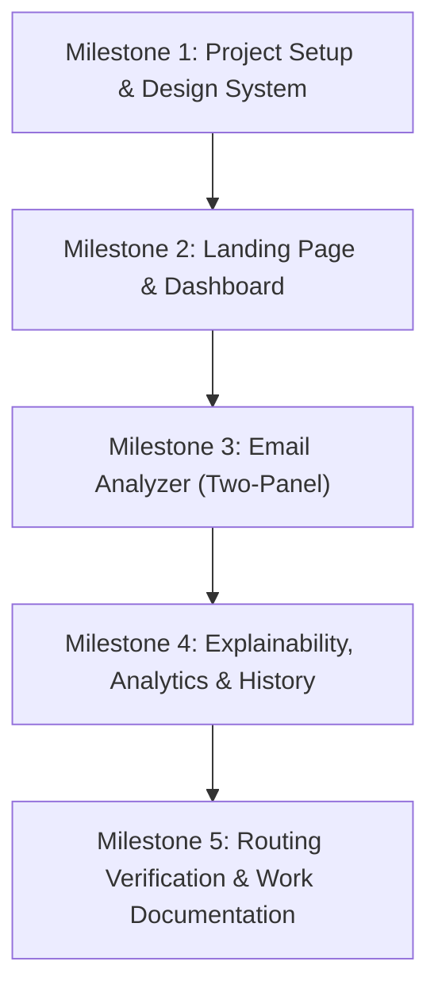

# PhishGuard AI — Project Development Documentation & Work Log

> **Project:** Explainable AI-Based Phishing Email Detection  
> **Repository:** `phishing-detector/phishing-detector`  
> **Application Package:** `phishguard-ai`  
> **Initial Release Date:** 2026-11-10  
> **Last Updated:** 2026-11-10T11:48:00+05:30  
> **Maintained By:** Pair Programming Assistant (Antigravity) & Preetham Kumar  

---

## 1. Executive Summary & Objective

**PhishGuard AI** is a cybersecurity web application engineered to bridge the gap between complex deep learning language models and actionable, transparent email threat intelligence.

While traditional filters rely on static signatures or black-box classifiers, this platform is built around an explainable multi-scale neural architecture:
- **BERT Transformer Backbone:** Extracts 768-dimensional contextual token representations.
- **Multi-Head Attention (MHA):** Highlights correlated linguistic threat patterns (e.g., pairing urgency terms with credential solicitation).
- **1D-CNN + Bidirectional GRU:** Captures local n-gram syntax alongside long-range sequential context.
- **Mountain Gazelle Optimizer (MGO):** Adaptive metaheuristic hyperparameter tuning.

This documentation serves as the **living work log and technical specification** for the project. It tracks every completed task, architecture decision, route implementation, and upcoming milestone.

---

## 2. Technical Stack & Standards

| Layer | Selected Technology | Purpose & Role |
|---|---|---|
| **Framework** | Next.js 16.4.6 (App Router) | High-performance React application, static optimization, and routing |
| **Language** | TypeScript 5 (Strict Mode) | Strong typing across data models, scan results, and service contracts |
| **Styling** | Tailwind CSS v4 | Dark-first design tokens, responsive breakpoints, accessible utility styling |
| **Visualizations** | Recharts 2.x | Responsive SVG-based telemetry charts (threat distribution, activity, loss curves) |
| **Iconography** | Lucide React + Custom Brand SVGs | Consistent UI icons and brand emblems (GitHub, YouTube) |
| **Service Layer** | Typed TypeScript Modules (`scanService.ts`) | Decoupled abstraction separating UI from the mock/production backend |
| **Build & Tooling** | Turbopack / npm | Rapid compilation, route verification, and tree-shaking |

### Visual Design Tokens
- **Background:** `#090D18` (Primary App Canvas)
- **Sidebar:** `#101729` (Left Application Shell)
- **Cards & Surfaces:** `#151E31` (Content Panels)
- **Elevated Surfaces:** `#1B2740` (Interactive Inputs & Hovers)
- **Accents:** `#8B5CF6` (Primary Violet), `#3B82F6` (Secondary Blue)
- **Status Identifiers:** Safe (`#22C55E`), Threat (`#EF4444`), Review (`#F59E0B`), Border (`#273449`)

---

## 3. Work Log & Milestone History



### Milestone Log Table

| Entry ID | Date & Time | Milestone / Task | Status | Summary of Deliverables |
|---|---|---|---|---|
| **WL-001** | 2026-11-10 11:38 | Project Initialization | Completed | Next.js App Router project created with TypeScript, Tailwind CSS, Lucide React, and Recharts. Root package script forwarding configured. |
| **WL-002** | 2026-11-10 11:42 | Design Tokens & Global CSS | Completed | Dark-first theme variables, custom scrollbars, and typography configured in `globals.css`. |
| **WL-003** | 2026-11-10 11:44 | UI Component Primitives | Completed | Created reusable `Button`, `Card`, `Badge`, `ClassificationBadge`, `Tabs`, `Dialog`, `Skeleton`, and `DemoDataNotice`. |
| **WL-004** | 2026-11-10 11:46 | Responsive Application Shell | Completed | Implemented persistent collapsible `Sidebar`, responsive `TopBar` with breadcrumbs and search, mobile drawer, and `ProfileSummaryCard`. |
| **WL-005** | 2026-11-10 11:49 | Landing Page (`/`) | Completed | Built public hero section, feature cards, 3-step workflow, research architecture preview, contact modal, and demo sign-in dialog. |
| **WL-006** | 2026-11-10 11:51 | Main Dashboard (`/dashboard`) | Completed | Implemented 4 KPI cards, Threat Distribution donut chart, Scan Activity area chart, Recent Scans table with live filtering, and profile summary panel. |
| **WL-007** | 2026-11-10 11:52 | Email Analyzer (`/analyzer`) | Completed | Built strict two-panel layout: Left for Paste/Upload inputs with quick sample buttons; Right for empty, loading, and result states with confidence and indicators. |
| **WL-008** | 2026-11-10 11:53 | Explainable AI (`/explainability`) | Completed | Built interactive token importance heatmap, attribution method switcher (MHA, SHAP, LIME), ranked feature bars, and scientific faithfulness notes. |
| **WL-009** | 2026-11-10 11:54 | Model Evaluation (`/analytics`) | Completed | Built research analytics page with Accuracy/Precision/Recall/F1 cards, 4-quadrant Confusion Matrix, loss curves, and model comparison table. |
| **WL-010** | 2026-11-10 11:55 | Scan History (`/history`) | Completed | Built audit log table with search, status filtering, date range selector, pagination, detail inspection modal, and export dialog. |
| **WL-011** | 2026-11-10 11:56 | Research Placeholders & Settings | Completed | Built `/research/architecture`, `/research/datasets`, `/research/sources`, `/research/papers`, `/settings`, and `/account`. |
| **WL-012** | 2026-11-10 11:57 | Type Checking & Production Build | Completed | Verified full production compilation (`next build`) with 0 errors across all 13 routes. |
| **WL-013** | 2026-11-10 11:48 | Project Documentation Setup | Completed | Created central documentation and live work log (`PROJECT_WORK_DOCUMENTATION.md`) to be updated after every task. |
| **WL-014** | 2026-11-10 12:15 | Git Commit & Remote Push | Completed | Staged all frontend files and documentation, committed (`30be1b9`), rebased on latest `origin/main`, and successfully pushed to GitHub. |

---

## 4. Route & Architecture Registry

```
phishguard-ai/
├── public/
├── src/
│   ├── app/
│   │   ├── (marketing)/
│   │   │   └── page.tsx              # Public Landing Page (Page 1)
│   │   ├── (app)/
│   │   │   ├── layout.tsx            # AppShell wrapper (Sidebar + TopBar)
│   │   │   ├── dashboard/page.tsx    # Operational Overview (Page 2)
│   │   │   ├── analyzer/page.tsx     # Two-Panel Email Analyzer (Page 3)
│   │   │   ├── explainability/page.tsx # Token Heatmap & Attribution (Page 4)
│   │   │   ├── analytics/page.tsx    # Research Metrics & Loss Curves (Page 5)
│   │   │   ├── history/page.tsx      # Forensic Audit Log (Page 6)
│   │   │   ├── research/
│   │   │   │   ├── architecture/page.tsx # Neural Pipeline Blueprint
│   │   │   │   ├── datasets/page.tsx     # Corpus Curation & Splits
│   │   │   │   ├── sources/page.tsx      # Literature References
│   │   │   │   └── papers/page.tsx       # Publications & Preprints
│   │   │   ├── settings/page.tsx     # Endpoint & Threshold Preferences
│   │   │   └── account/page.tsx      # Researcher Profile & API Keys
│   │   ├── globals.css
│   │   └── layout.tsx
│   ├── components/
│   │   ├── analyzer/                 # Input & Result panels
│   │   ├── dashboard/                # KPI cards, Recharts, recent scans
│   │   ├── layout/                   # AppShell, Sidebar, TopBar, Header
│   │   └── ui/                       # Shared atomic UI primitives
│   ├── config/                       # Sidebar & public navigation maps
│   ├── data/                         # Typed demo records & benchmarks
│   ├── lib/                          # Utility functions (cn, formatters)
│   ├── services/                     # scanService (API integration ready)
│   └── types/                        # ScanResult, ScanRecord, Metrics
```

---

## 5. Backend Integration Blueprint

All analyzer logic is strictly isolated in `phishguard-ai/src/services/scanService.ts`.

### Expected Production API Contract

```typescript
// POST /api/v1/predict
export interface AnalyzeEmailInput {
  subject?: string;
  sender?: string;
  body: string;
}

export type ScanResult = {
  scanId: string;
  prediction: "phishing" | "safe" | "needs_review";
  confidence?: number;
  summary?: string;
  evidence: Array<{
    text: string;
    reason: string;
    severity?: "critical" | "high" | "medium" | "low";
    start?: number;
    end?: number;
  }>;
  modelVersion?: string;
  processingTimeMs?: number;
  isDemo: boolean;
};
```

When connecting to the live Python / FastAPI inference server:
1. Update `apiUrl` in `phishguard-ai/src/app/(app)/settings/page.tsx` or `.env.local` (`NEXT_PUBLIC_API_URL`).
2. Replace the heuristic simulation in `analyzeEmail()` with:
   ```typescript
   const res = await fetch(`${process.env.NEXT_PUBLIC_API_URL}/predict`, {
     method: "POST",
     headers: { "Content-Type": "application/json" },
     body: JSON.stringify(input),
   });
   return await res.json();
   ```
3. No UI components require modification.

---

## 6. Maintenance & Documentation Protocol

To maintain complete transparency and traceability:
1. **Regular Updates:** Every time new features, model integrations, bug fixes, or design adjustments are executed, a new entry (`WL-xxx`) will be appended to Section 3.
2. **Status Tracking:** Completed components, active development, and upcoming milestones will be reflected in both the repository file and the companion conversation artifact.
3. **Reproducibility:** Test commands, compilation checks, and environment configurations must be documented alongside any code modification.

