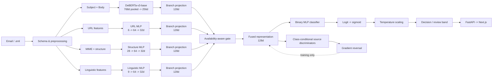
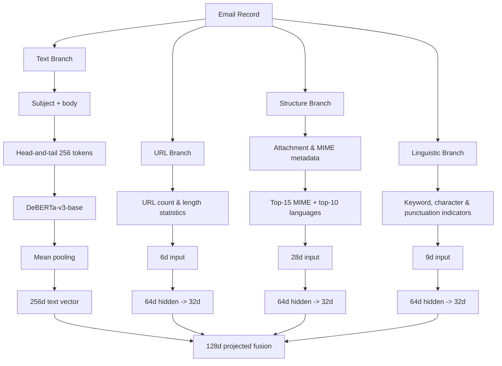
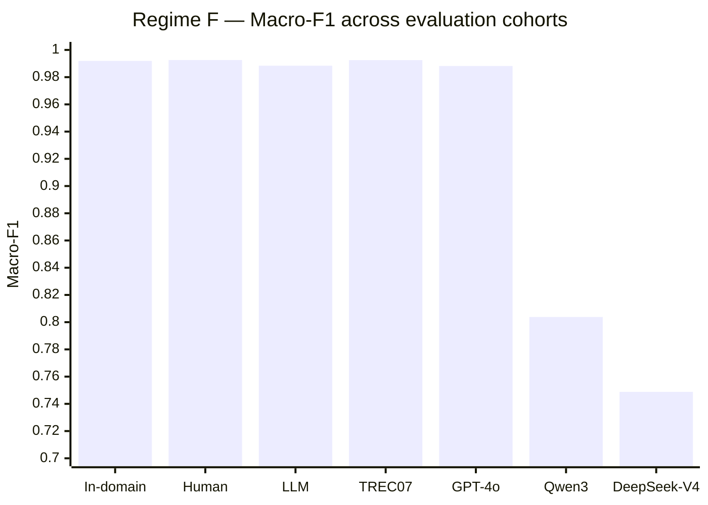
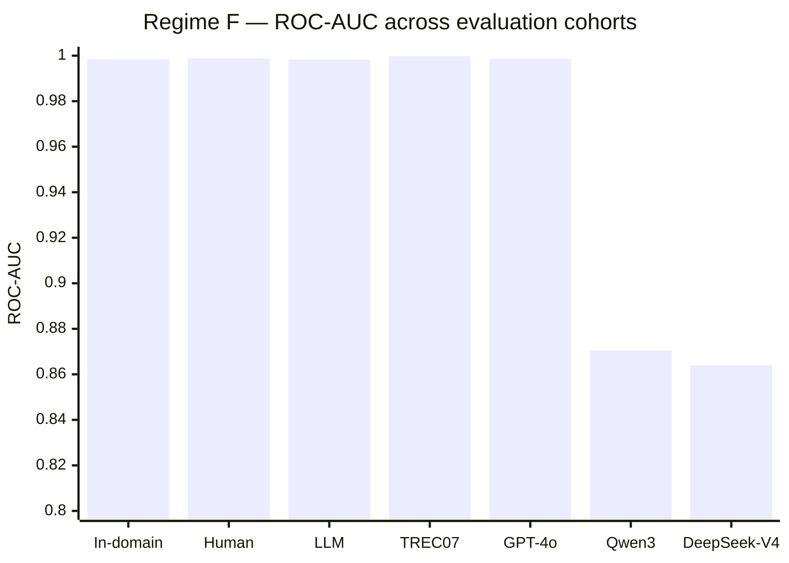

                                                              # PhishIntel

<div align="center">

**Explainable phishing-email and URL intelligence powered by PAHF-Net**

[](https://www.python.org/)
[](https://pytorch.org/)
[](https://fastapi.tiangolo.com/)
[](https://nextjs.org/)
[](https://www.typescriptlang.org/)
[](#license)

[Quick Start](#-quick-start) · [Architecture](#-architecture) · [Model Performance](#-model-performance) · [Features](#-features) · [API](#-api) · [Evaluation](#-evaluation-dashboard) · [Development](#-development)

**Regime F holdout artifact**

`99.19%` Macro-F1 · `99.84%` ROC-AUC · `14,294` test emails

</div>

---

## What is PhishIntel?

PhishIntel is an end-to-end email-security platform that combines a **Transformer-based content model**, compact structured-feature encoders, availability-aware fusion, and offline verification signals.

The system provides:

- Email and `.eml` analysis
- Sender, reply-to, header, URL, and attachment-oriented evidence
- Calibrated malicious-email probability
- Explainable modality contributions
- Scan history and forensic PDF export
- Automatic local backend discovery
- Artifact-backed evaluation metrics

> **Scope:** This repository detects malicious email in the Anti-PLUTO / broader email corpus context. It should not be described as detecting every targeted-phishing threat or replacing mail-gateway controls.

<details>
<summary><b>Why PAHF-Net?</b></summary>

Email evidence is heterogeneous. A subject and body carry language, URLs carry link statistics, MIME and attachment metadata describe structure, and selected linguistic indicators summarize writing patterns.

PAHF-Net encodes these views through separate branches, projects them into a shared representation, and gates unavailable or less-useful evidence rather than assuming every email has every modality.

</details>

---

## Highlights

| Area | Result |
|---|---|
| Text encoder | Microsoft DeBERTa-v3-base, 768d hidden state, mean pooled |
| Encoded representation | Text `256d` + URL `32d` + Structure `32d` + Linguistic `32d` |
| Shared fusion | `128d` availability-gated representation |
| Max text length | `256` tokens with 192 head + 62 tail tokens |
| Training seed | `42` |
| Training hardware | Kaggle, 2 × NVIDIA Tesla T4 GPUs |
| Holdout sample | `14,294` emails |
| Holdout Macro-F1 | `0.9919` |
| Holdout ROC-AUC | `0.9984` |
| Holdout PR-AUC | `0.9975` |
| Holdout accuracy | `99.24%` |

---

## Product Preview

<table>
  <tr>
    <td width="50%">
      <h3>Analyzer</h3>
      Inspect raw email text or <code>.eml</code> files, review threat indicators, and visualize PAHF-Net modality evidence.
    </td>
    <td width="50%">
      <h3>Evaluation</h3>
      Review artifact-backed metrics, confusion matrix, ROC curve, and operating thresholds.
    </td>
  </tr>
  <tr>
    <td width="50%">
      <h3>Explainability</h3>
      Trace branch availability and gate weights for a selected stored scan.
    </td>
    <td width="50%">
      <h3>Audit & Export</h3>
      Search scan history, filter decisions, and export a forensic-style PDF report.
    </td>
  </tr>
</table>

---

## Architecture

### End-to-End System



<details open>
<summary><b>Interactive branch map</b></summary>



</details>

### Availability-Gated Fusion

Each branch is projected into a shared `128d` space. A learned gate assigns branch weights while an availability mask gives unavailable branches an effectively zero softmax weight.

$$
h_{\text{fused}}=\sum_{i\in\{\text{text,url,structure,linguistic}\}} g_i z_i
$$

$$
\sum_i g_i=1,\qquad g_i=0\text{ for an unavailable branch}
$$

Modality dropout (`p = 0.2`) randomly disables non-text branches during training. Text is always retained.

### Training Objectives

```mermaid
flowchart TB
    X[Shared representation] --> C[Malicious-email classifier]
    X --> B[Benign-source discriminator]
    X --> M[Malicious-source discriminator]
    C --> BCE[BCEWithLogitsLoss]
    B --> DS1[Benign source loss]
    M --> DS2[Malicious source loss]
    DS1 --> GRL[Gradient Reversal Layer]
    DS2 --> GRL
    GRL -. $\lambda_{source}=0.1$ .-> X
```

The source discriminator routes an email to the head matching its true class. The reported setup uses **10 benign sources** and **11 malicious sources**.

---

## Model Performance

### Regime F — Deployment-Oriented Holdout

Regime F uses TREC07 in grouped training while holding out GPT-4o, Qwen3, and DeepSeek-V4. All values below are from the research handoff and the repository evaluation artifact.

| Evaluation set | Samples | Macro-F1 | ROC-AUC | FPR | FNR | ECE |
|---|---:|---:|---:|---:|---:|---:|
| In-domain test | 14,294 | 0.9919 | 0.9984 | 0.0065 | 0.0094 | 0.0020 |
| Human test | 11,925 | 0.9926 | 0.9988 | 0.0062 | 0.0079 | 0.0027 |
| LLM test | 2,369 | 0.9884 | 0.9983 | 0.0082 | 0.0155 | 0.0084 |
| TREC07 in-domain | 4,817 | 0.9925 | 0.9998 | 0.0029 | 0.0090 | 0.0102 |
| Unseen GPT-4o | 4,000 | 0.9882 | 0.9987 | 0.0195 | 0.0040 | 0.0090 |
| Unseen Qwen3 | 903 | 0.8038 | 0.8706 | 0.1340 | 0.2460 | 0.1826 |
| Unseen DeepSeek-V4 | 744 | 0.7488 | 0.8640 | 0.0526 | 0.3441 | 0.2445 |

<details>
<summary><b>View Macro-F1 comparison</b></summary>



</details>

<details>
<summary><b>View ROC-AUC comparison</b></summary>



</details>

### Regime T — Cross-Source Transfer

Regime T excludes TREC07 and selected GPT-4o cohorts from training.

| Evaluation set | Samples | Macro-F1 | ROC-AUC | FPR | FNR | ECE |
|---|---:|---:|---:|---:|---:|---:|
| In-domain test | 9,477 | 0.9854 | 0.9980 | 0.0091 | 0.0142 | 0.0067 |
| Human test | 7,108 | 0.9863 | 0.9983 | 0.0063 | 0.0120 | 0.0068 |
| LLM test | 2,369 | 0.9803 | 0.9970 | 0.0217 | 0.0165 | 0.0133 |
| Unseen TREC07 | 46,971 | 0.8379 | 0.9604 | 0.2574 | 0.0825 | 0.1250 |
| Unseen GPT-4o | 4,000 | 0.9710 | 0.9934 | 0.0530 | 0.0050 | 0.0266 |
| Unseen Qwen3 | 903 | 0.7750 | 0.8613 | 0.2457 | 0.2040 | 0.1853 |
| Unseen DeepSeek-V4 | 744 | 0.7510 | 0.8764 | 0.1336 | 0.2938 | 0.2109 |

### Repository Holdout Artifact

The artifact-backed in-domain evaluation contains `14,294` samples: `9,070` legitimate and `5,224` phishing.

| Metric | Value |
|---|---:|
| Accuracy | 99.2444% |
| Balanced accuracy | 99.2658% |
| Precision | 98.8728% |
| Recall | 99.0620% |
| F1 | 98.9673% |
| Macro-F1 | 99.1900% |
| ROC-AUC | 99.8400% |
| PR-AUC | 99.7500% |

|  | Predicted Legitimate | Predicted Phishing |
|---|---:|---:|
| Actual Legitimate | 9,011 | 59 |
| Actual Phishing | 49 | 5,175 |

<details>
<summary><b>Calibration and operating thresholds</b></summary>

| Setting | Regime T | Regime F |
|---|---:|---:|
| Temperature | 1.1348 | 1.2180 |
| Optimal-F1 threshold | 0.5400 | 0.2550 |
| 1% FPR threshold | 0.1322 | 0.0331 |
| Review lower threshold | 0.5000 | 0.2872 |
| Review upper threshold | 0.9900 | 0.5000 |

`config.json` is the runtime configuration currently used by the service and records the Regime F values.

</details>

### Ablation Snapshot

| Variant | Validation ROC-AUC | Validation Macro-F1 | Worst-source AUC |
|---|---:|---:|---:|
| E0 Text-only | 0.9994 | 0.9883 | 0.9972 |
| E1 Concatenation + MLP | 0.9997 | 0.9924 | 0.9977 |
| E2 Gated fusion | 0.9997 | 0.9911 | 0.9985 |
| E5 Full PAHF-Net | 0.9992 | 0.9900 | 0.9974 |

Concatenation improved recorded validation Macro-F1 by `0.0041` over the text-only baseline. The gated model did not exceed the concatenation baseline, and the completed E0–E5 controlled ablation remains incomplete.

<details>
<summary><b>Recorded gate weights</b></summary>

| Cohort | Text | URL | Structure | Linguistic |
|---|---:|---:|---:|---:|
| E2 validation | 0.918 | 0.003 | 0.077 | 0.003 |
| E5 T validation | 0.961 | 0.003 | 0.033 | 0.004 |
| E5 held-out TREC07 | 0.711 | 0.004 | 0.281 | 0.003 |
| Regime F | 0.9882 | 0.0002 | 0.0114 | 0.0003 |

Gate weights show strong text dominance. They do not by themselves prove that low-weight branches are harmful or beneficial.

</details>

---

## Features

### Detection

- PAHF-Net text + structured-feature inference
- Calibrated phishing probability and risk score
- Review-band support for uncertain predictions
- URL, header, sender, reply-to, and `.eml` inspection
- Correction-score filtering for legitimate financial, billing, subscription, and promotional messages
- Offline domain verification fused with model output

### Application

- Analyzer with phishing, BEC, and legitimate examples
- Explainability workspace with branch evidence and gate weights
- Evaluation dashboard with confusion matrix and ROC visualization
- Searchable, paginated scan history
- Landscape forensic PDF export
- Runtime backend discovery and health checks
- SQLite-backed profile, sessions, preferences, and account activity

---

## Repository Layout

```text
phishing-detector/
├── backend/
│   ├── app/
│   │   ├── api/routes.py
│   │   ├── services/model_service.py
│   │   └── services/evaluation_service.py
│   ├── saved_models/
│   │   ├── pahf_net.pt
│   │   ├── pahf_net_regime_T.pt
│   │   ├── pahf_net_regime_F.pt
│   │   ├── features*.joblib
│   │   ├── tokenizer/
│   │   ├── config.json
│   │   └── evaluation_metrics.json
│   └── tests/
├── phishintel-ai/
│   ├── src/app/
│   ├── src/components/
│   ├── src/context/
│   ├── src/lib/
│   └── src/services/
└── docs/
```

---

## Quick Start

### Requirements

- Python `3.10+`
- Node.js `20.9+`
- npm
- Git with Git LFS
- Optional CUDA-capable PyTorch environment

### 1. Restore model assets

```bash
git lfs install
git lfs pull
```

Confirm that `backend/saved_models/pahf_net.pt` and `backend/saved_models/tokenizer/` contain real assets rather than LFS pointer files.

### 2. Start the backend

```bash
cd backend
python -m venv .venv

# Linux / macOS
source .venv/bin/activate

# Windows PowerShell
# .\.venv\Scripts\Activate.ps1

python -m pip install --upgrade pip
python -m pip install -r requirements.txt
uvicorn app.main:app --reload --host 127.0.0.1 --port 8000
```

Backend URLs:

| URL | Purpose |
|---|---|
| `http://127.0.0.1:8000/docs` | OpenAPI documentation |
| `http://127.0.0.1:8000/health` | Backend and endpoint health |
| `http://127.0.0.1:8000/healthz` | Service and model readiness |
| `http://127.0.0.1:8000/api/v1/models` | Model runtime status |

### 3. Start the frontend

```bash
cd phishintel-ai
npm install
npm run dev
```

Open `http://localhost:3000`.

To configure a manual endpoint:

```dotenv
# phishintel-ai/.env.local
NEXT_PUBLIC_FASTAPI_URL=http://127.0.0.1:8000
```

The backend writes a local `public/runtime-backend.json` descriptor during startup. The file is generated state and is not intended to be committed.

---

## API

| Method | Endpoint | Purpose |
|---|---|---|
| `POST` | `/api/v1/analyze` | Analyze an email |
| `POST` | `/api/v1/scan` | Compatibility alias for analyze |
| `GET` | `/api/v1/models` | Model readiness and runtime information |
| `GET` | `/api/v1/evaluation-metrics` | Artifact-backed evaluation report |
| `GET` | `/health` | Backend health and active endpoint |
| `GET` | `/healthz` | Backend and model readiness |

The router is also mounted under `/api` for compatibility.

<details>
<summary><b>Example scan response</b></summary>

```json
{
  "success": true,
  "scan_id": "scan-example",
  "is_phishing": true,
  "verdict": "Phishing",
  "confidence_score": 0.94,
  "risk_score": 94,
  "p_phish": 0.94,
  "indicators": [],
  "explainability": {}
}
```

The exact fields are validated against `ScanResponse` in `backend/app/schemas/scan.py`.

</details>

---

## Evaluation Dashboard

`GET /api/v1/evaluation-metrics` reads `backend/saved_models/evaluation_metrics.json`.

- Missing artifact: HTTP `200` with `status: unavailable`
- Invalid artifact: rejected by the evaluation service
- No request-time metric fabrication
- No baseline ranking is invented when ranking data is absent

The UI presents:

- Accuracy, precision, recall, F1, and ROC-AUC
- Confusion matrix
- ROC operating curve
- Dataset support and class distribution
- Evaluated model metadata

---

## Development

### Backend tests

```bash
cd backend
python -m unittest discover -s tests
```

### Frontend checks

```bash
cd phishintel-ai
npm exec tsc -- --noEmit
npm run lint
npm run build
npm test
```

### Regression samples

Use `phishintel_test_eml_samples.zip` to test:

- Legitimate SaaS invoice
- Legitimate bank e-statement
- Credential-harvesting phishing
- BEC transfer request
- Legitimate rewards/promotional edge case

---

## Research Limitations

- Qwen3 and DeepSeek-V4 remain a generalization gap: `0.8038` and `0.7488` Macro-F1 in Regime F.
- Masking alignment between training and inference should be verified.
- The complete controlled E0–E5 ablation is pending.
- Missing-feature stress tests and cross-variant robustness tests are pending.
- Gate weights show strong text dominance.
- GRL encourages source-independent representations but does not guarantee invariance.
- Performance depends on the selected corpus, split, threshold, masking pipeline, and generator distribution.

This repository is a research and decision-support system, not a completed production security guarantee.

---

## Responsible Use

Email content may contain personal, financial, authentication, or confidential information. Analyze only authorized email, protect stored scan records, and review uncertain or high-impact decisions before taking action.

Model output is decision support. It should complement, not replace, SPF/DKIM/DMARC, secure mail gateways, URL filtering, identity controls, and analyst review.

---

## License

No license is currently declared in this repository. Confirm the intended license before distribution or commercial use.
